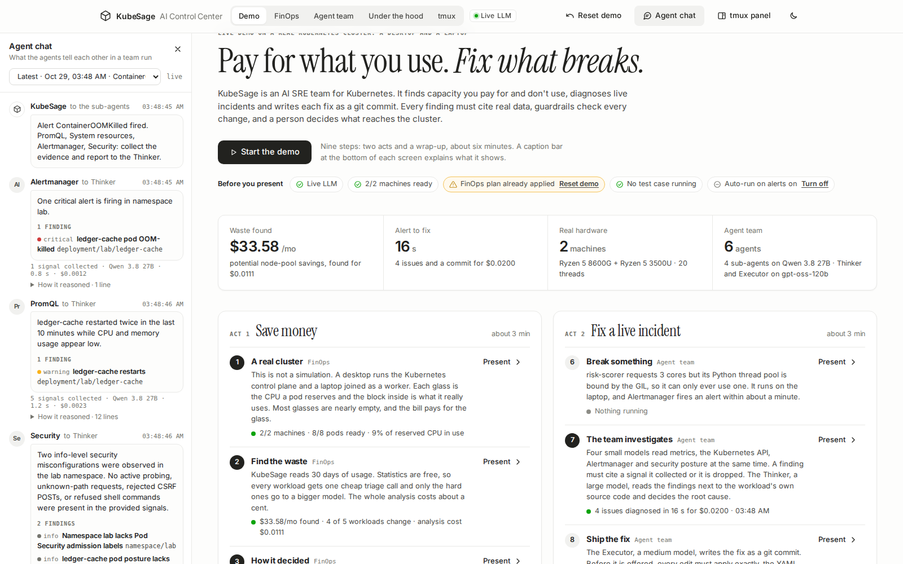
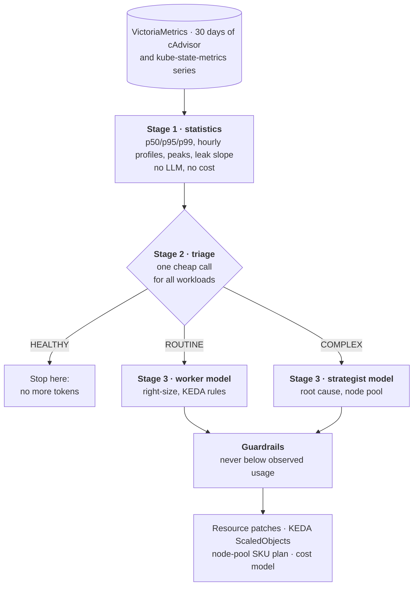
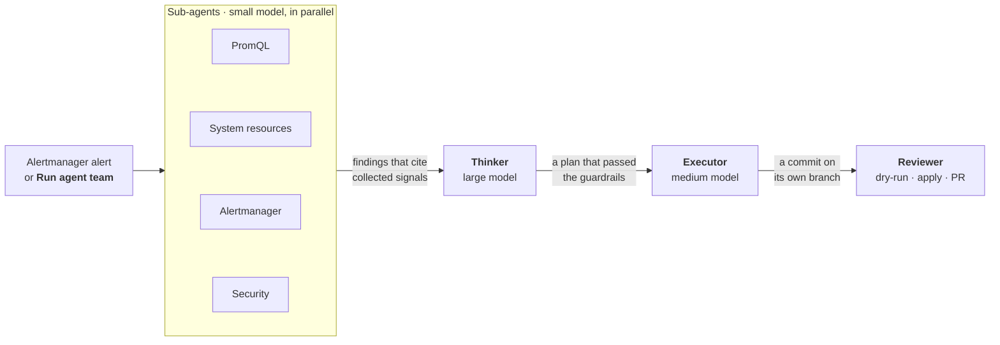
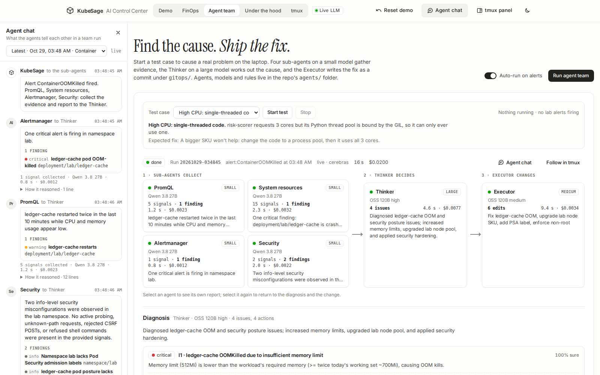
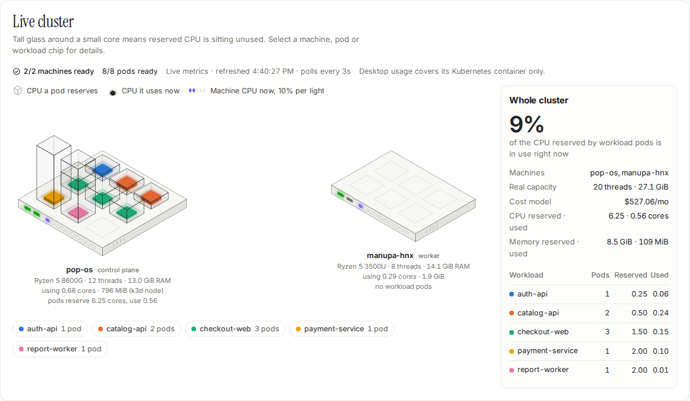

<div align="center">


# KubeSage

**An AI SRE team for Kubernetes.** It finds the capacity you pay for and don't use, diagnoses live incidents, and
ships every fix as a reviewable git commit.

[](pyproject.toml)
[](docs/cluster.md)
[](docs/pipeline.md)
[](docs/configuration.md)
[](docs/testing.md)

[Quickstart](#quickstart) · [How it works](#how-it-works) · [Control Center](#the-ai-control-center) ·
[Agent team](#the-agent-team) · [Documentation](#documentation)

<br>

<picture>
  <source media="(prefers-color-scheme: dark)" srcset="docs/images/readme-demo-dark.png">
  
</picture>

</div>

## Overview

KubeSage tells two stories on a real cluster, a desktop and a laptop joined as one:

1. **This cluster wastes money.** It reads 30 days of usage, right-sizes every workload, adds proactive KEDA
   autoscaling, picks a cheaper machine type for the node pool and shows the dollar math. Then it proves the
   right-sized cluster still scales under real traffic.
2. **Something just broke.** When an alert fires, four small-model sub-agents gather evidence, a large-model
   Thinker finds the root cause, and an Executor writes the fix as a git commit on its own branch, ready to dry-run,
   apply or open as a pull request.

It also accounts for its own bill. Every model call is metered in tokens and dollars, and a cost-aware router only
sends a workload to an expensive model when a cheap one says it needs to.

### Measured on the real cluster

| scenario | result |
|---|---|
| **Right-sizing analysis** | Node pool `D8s_v5` → `F8s_v2`: **$280.32 → $246.74 a month**, 4 of 5 workloads changed. The analysis cost **$0.0111** in model calls |
| **Live incident** (`ContainerOOMKilled`) | Alert to diagnosis and commit in **16 s** for **$0.0200**: 4 issues, 4 actions, 3 files changed |
| **Scaling under load** | `checkout-web` scaled 2 → 7 pods, and p95 latency fell from **377 ms to ~110 ms** with zero errors |

Prices are Azure list prices: each real machine stands in for the cloud VM its `kubesage.io/sku` label names.

## Why it's different

| | |
|---|---|
| **Evidence, or it's dropped** | Every finding must cite a signal an agent actually collected. Guardrails reject actions with no evidence, unknown targets, machine types outside the catalog and requests bigger than a real node. The model gets one retry, with the reasons. |
| **Small models do the legwork** | Statistics are computed without an LLM. Cheap models triage and gather evidence; only the hard cases reach the large model. An incident run costs a few cents, and a full right-sizing analysis about one cent. |
| **People stay in charge** | Models return structured parameters, never raw YAML. Every change is a git commit on its own branch. The web shell is read-only, the terminal views are mirrors, and nothing reaches the cluster until someone presses **Apply**. |

## Quickstart

Requirements: Docker and Python 3.11+. No API key is needed: without one, every model call runs in a labelled,
deterministic mock mode.

```bash
python3 -m venv .venv && .venv/bin/pip install -e '.[dev]'
docker compose up -d                  # VictoriaMetrics :8428, Grafana :3300, vmalert + Alertmanager :9193
.venv/bin/kubesage simulate           # backfill 30 days of realistic history (~1.4M samples, ~2 s)
.venv/bin/kubesage analyze            # full pipeline; writes out/<run>/report.json and manifests/
.venv/bin/kubesage serve              # the AI Control Center on http://127.0.0.1:8600
```

To call a real model, put a key in `.env` (gitignored) and pick a provider profile:

```bash
echo 'CEREBRAS_API_KEY=...' > .env
set -a; . ./.env; set +a
KUBESAGE_MODELS=cerebras .venv/bin/kubesage serve
```

### Run it on a cluster

```bash
scripts/cluster-up.sh                 # pinned k3d + kubectl into .bin/, a k3d cluster with KEDA and the demo apps
scripts/live-up.sh                    # kube-state-metrics + vmagent: live metrics on top of the 30-day history
scripts/join-node.sh user@laptop      # optional: a second real machine joins over SSH as a k3s agent
.venv/bin/kubesage apply --dry-run    # server-side dry run of the latest analysis
.venv/bin/kubesage apply              # Deployment patches first, then ScaledObjects
.venv/bin/kubesage spike              # real CPU-heavy traffic; watch KEDA scale checkout-web out
```

Tools go to `.bin/` and the kubeconfig to `.bin/kubeconfig`; `~/.kube/config` is never touched.
`scripts/demo-reset.sh` puts the demo back in its oversized "before" state, and `scripts/cleanup.sh --check` lists
everything that's installed. [docs/cluster.md](docs/cluster.md) covers the two-machine setup and its networking,
and [docs/operations.md](docs/operations.md) is the runbook and demo-day checklist.

## How it works

### Right-sizing: a three-stage, cost-aware router



Models return parameters, never YAML. Deterministic guardrails clamp anything below observed usage, and every
clamp is reported, so a bad answer can't OOM-kill a pod. Scale-to-zero is allowed only for workloads that the
statistics flag as batch jobs. The output can be applied directly or committed to your GitOps repo as a kustomize
overlay with a pull request (`kubesage gitops`). [docs/pipeline.md](docs/pipeline.md) has the details.

### Incident response: the agent team



| agent | model | what it does |
|---|---|---|
| **PromQL** | small | Container CPU, throttling, threads, memory, OOM kills, disk I/O and latency, from VictoriaMetrics |
| **System resources** | small | Nodes, pod scheduling, disk and volume usage and warning events, from the Kubernetes API and kubelet |
| **Alertmanager** | small | What is firing in Alertmanager right now |
| **Security** | small | Pod security posture, workloads created outside GitOps, RBAC, and probes against the Control Center |
| **Thinker** | large | Reads every finding plus the custom rules, finds the root causes and decides what to do |
| **Executor** | medium | Turns the plan into exact edits under `gitops/`, checked against policy before it commits |

Agents, models and plain-English platform rules are files in [`agents/`](agents/README.md): changing an agent's
model is a one-line edit. Nine live **test cases** break the lab namespace on purpose so the team has something
real to fix: high memory, CPU throttling, single-threaded code, disk I/O, a full disk, latency, Pending pods, pod
density and a hand-made insecure pod. [docs/agents.md](docs/agents.md) walks through all of it.

## The AI Control Center

`kubesage serve` opens a single-page app built for presenting live. It's plain HTML, CSS and JavaScript with no build
step and no CDN, and its fonts are vendored, so it works on venue Wi-Fi.

| view | what it shows |
|---|---|
| **Demo** | The pitch, live headline numbers, pre-flight checks and a nine-step run of show with a caption bar |
| **FinOps** | Savings, an isometric drawing of the live cluster, reserved-vs-used evidence, the router's decisions and the three steps: Analyze, Apply, Send traffic |
| **Agent team** | Test cases, the sub-agents → Thinker → Executor diagram, the diagnosis and the diff |
| **Under the hood** | The pipeline stage by stage, a read-only shell, the journal, and every PromQL, LLM and `kubectl` call of a run |
| **tmux** | A read-only mirror of every terminal stream, laid out like tmux |
| **Agent chat** (left sidebar) | Each team run as the messages the agents hand each other, with each model's reasoning |
| **tmux panel** (right sidebar) | The same terminal mirror, beside any view |

<table>
  <tr>
    <td width="50%"></td>
    <td width="50%"></td>
  </tr>
  <tr>
    <td><b>Agent team.</b> The agent chat on the left shows each sub-agent's report to the Thinker, the Thinker's plan and the Executor's commit.</td>
    <td><b>Live cluster.</b> Each pod is a glass box as tall as its CPU request, with a core as tall as the CPU it uses right now.</td>
  </tr>
</table>

Every part of every view is explained in the [UI guide](docs/ui-guide.md).

## Security model

- **Read-only by default.** The web shell runs a fixed allow-list of read-only commands. The RAM ring behind the
  terminal views has no write endpoint, and nothing typed in a browser reaches a terminal.
- **Guarded writes.** Every agent edit must apply exactly, parse, stay inside its action's files and pass the
  policy: only the lab namespace, only known kinds, and requests that fit a real node. Apply re-checks the rendered
  objects before it sends them.
- **A person decides.** Changes are commits on their own branches. Apply asks first; pull requests need
  `--agent-prs`.
- **Local first.** The server binds to `127.0.0.1`, and POSTs need an `X-KubeSage` header, so another site in the
  same browser can't trigger actions. Use `--host 0.0.0.0` only on a network you trust.
- **No secrets in the repo.** API keys come from the environment (`.env` is gitignored), and traces and ring dumps
  redact them.

## Configuration

| what | where |
|---|---|
| Model tiers, prices and provider | [`config/models.yaml`](config/models.yaml), or a profile `config/models.<name>.yaml` selected with `KUBESAGE_MODELS=<name>` |
| Agent team models | [`agents/models.yaml`](agents/models.yaml), one size (`small`, `medium`, `large`) per agent |
| Machine catalog and prices | [`config/skus.yaml`](config/skus.yaml) |
| Platform rules for the agents | [`agents/rules/`](agents/rules/), plain English |

Any OpenAI-compatible endpoint works. Two profiles ship: Cerebras (`gpt-oss-120b`, `qwen-3.8-27b`) and the Meta
Model API. Model IDs and prices change, so check them before relying on the cost figures. Some of the Meta
profile's are marked unverified in the file. [docs/configuration.md](docs/configuration.md) lists every
environment variable.

## Command line

| command | what it does |
|---|---|
| `kubesage simulate` | Generate N days of synthetic demo metrics and backfill them |
| `kubesage stats` | Stage 1 only: deterministic statistics, no LLM calls |
| `kubesage analyze` | The full pipeline: stats → triage → recommendations → node pool |
| `kubesage apply` | Apply a run's manifests (the latest by default; `--dry-run` for a server-side check) |
| `kubesage gitops` | Commit a run to a GitOps repo as a kustomize overlay, optionally opening a PR |
| `kubesage serve` | The AI Control Center |
| `kubesage spike` | Send a burst of CPU-heavy traffic to a demo Service |
| `kubesage agents` | List the agent team, or run it once |
| `kubesage testcase` | Start or stop the live test cases in the `lab` namespace |
| `kubesage ring` | Read, tail or write the RAM ring that every terminal stream goes through |
| `kubesage tmux` | Open a tmux session over the ring: agents, test cases, journal and a piped ops shell |

## Repository layout

```
kubesage/            the Python package
  metrics/           PromQL client, collection, Stage 1 statistics
  llm/               schemas, prompts, OpenAI-compatible client with a cost ledger, mock tiers
  recommend/         guardrails, cost model, manifest renderer
  agents/            the team runner, guardrails, edit and policy checks
  lab/               the live test cases
  web/               the HTTP server and its API
  pipeline.py        the three-stage router
agents/              one folder per agent (prompt, collector, model size), models.yaml, rules/
dashboard/           the Control Center: HTML, CSS and JavaScript, no build step
gitops/              the lab apps and node pools the test cases deploy and the Executor edits
config/              model profiles and the machine catalog
deploy/              Grafana, alert rules, monitoring and demo manifests
scripts/             cluster up/down, joining a machine, live metrics, demo reset, cleanup
docs/                guides, architecture, runbook, test results
tests/               pytest suite and browser checks
```

## Documentation

| guide | read it for |
|---|---|
| [UI guide](docs/ui-guide.md) | **Start here.** Every view, what each shape and number means, and how to present the demo |
| [Agent team](docs/agents.md) | Sub-agents → Thinker → Executor, test cases, alerts, the RAM ring, tmux and PRs |
| [Architecture](docs/architecture.md) | Components, data flow, design decisions and a code map |
| [Pipeline](docs/pipeline.md) | Statistics, triage and routing, guardrails, manifests and the cost model |
| [Cluster](docs/cluster.md) | The real two-machine cluster: setup, networking and what gets installed |
| [Operations](docs/operations.md) | Runbook, after a reboot, the demo-day checklist |
| [API](docs/api.md) | The HTTP API and `report.json` |
| [Testing](docs/testing.md) | The test suite, browser checks and manual checks with their last results |
| [Cleanup](docs/cleanup.md) | What `scripts/cleanup.sh` removes on each machine, and what it never touches |

## Testing

```bash
.venv/bin/python -m pytest -q                                          # 141 tests, no cluster or API key needed
.venv/bin/pip install playwright && .venv/bin/python -m playwright install chromium
.venv/bin/python tests/browser_smoke.py --output-dir /tmp/kubesage-browser   # 37 UI checks against a mocked API
```

The browser checks drive the FinOps steps, the agent team, the tmux mirror, the agent chat and the demo guide,
check layouts in light and dark mode at phone, tablet and desktop widths, and confirm that untrusted model text is
always rendered as text.
