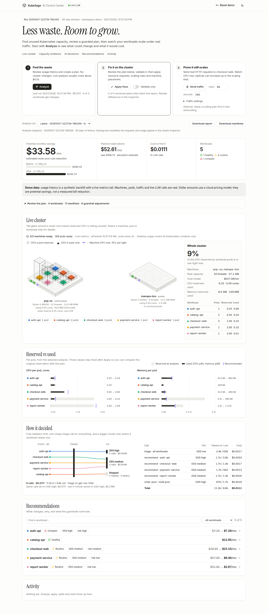

# KubeSage

AI FinOps agent for Kubernetes. It reads weeks of usage history and finds over-provisioned requests,
idle workloads that can scale to zero, recurring traffic peaks, and memory leaks. For each one it outputs
right-sized resource patches, proactive KEDA `ScaledObject`s and a cheaper node-pool SKU, with the dollar math.

It also tracks its own LLM bill: a 3-stage router only sends a workload to an expensive model when a
cheap one says it needs it.

**Docs:** [docs/](docs/README.md). Start with the [UI guide](docs/ui-guide.md). The demo runs on
[two real machines](docs/cluster.md), and there's a [handover](docs/HANDOVER.md) for reviewers.

```
 Prometheus / VictoriaMetrics
            │  30 days of cAdvisor + kube-state-metrics series
            ▼
 Stage 1  deterministic stats ─────────────── $0, no LLM: p50/p95/p99, hourly profiles,
            │                                 recurring peaks, leak slope, restarts
            ▼
 Stage 2  triage (Muse Glimmer) ──────────── one cheap call for all workloads
            │   HEALTHY → stop    ROUTINE → Spark    COMPLEX → Wonder
            ▼
 Stage 3  remediation (Muse Spark / Wonder) ─ returns parameters, not YAML
            │
            ▼
 guardrails (never below observed usage) → YAML renderer → cost model → node-pool plan (Wonder)
```

Models return structured parameters, never raw YAML. Deterministic guardrails clamp anything below observed
usage, and every clamp is reported, so a bad model answer can't OOM-kill a pod.

## Quickstart

Requirements: Docker, Python 3.11+.

```bash
python3 -m venv .venv && .venv/bin/pip install -e '.[dev]'
docker compose up -d                 # VictoriaMetrics :8428, Grafana :3300
.venv/bin/kubesage simulate          # backfill 30 days of synthetic history (~1.4M samples, ~2 s)
.venv/bin/kubesage stats             # Stage 1 only, no LLM
.venv/bin/kubesage analyze           # full pipeline; mock mode unless MODEL_API_KEY is set
```

Grafana: http://localhost:3300 (anonymous view, admin/admin to edit) opens the "requested vs used" dashboard.

`analyze` writes `out/<timestamp>/report.json` and `out/<timestamp>/manifests/*.yaml`.

### Local cluster + apply

A [k3d](https://k3d.io) cluster with KEDA, running the five demo Deployments in their oversized "before"
state: a tiny Python app per workload with requests far above what it uses. Adds ~600 MiB RAM.

```bash
scripts/cluster-up.sh                # downloads pinned k3d + kubectl into .bin/, creates cluster, installs KEDA
.venv/bin/kubesage apply --dry-run   # server-side dry run of the latest analysis run
.venv/bin/kubesage apply             # Deployment patches first, then ScaledObjects
scripts/demo-reset.sh                # back to the "before" state, to run the demo again
scripts/cleanup.sh --check           # what is still installed, on this machine and joined ones
scripts/cleanup.sh                   # delete the clusters (both machines); --all also wipes metrics, images, tools
```

[docs/cleanup.md](docs/cleanup.md) lists exactly what each level removes and what it never touches.

**Two real machines.** The demo cluster is the Ryzen 5 8600G desktop (k3s server in k3d) plus the Ryzen 5
3500U laptop, joined over SSH as a native k3s agent:

```bash
NODE_IP=192.168.1.9 scripts/cluster-up.sh             # publish API, kubelet and VXLAN on the desktop's LAN IP
scripts/live-up.sh
scripts/join-node.sh manupa@192.168.1.92              # laptop joins as a worker labelled F8s_v2
```

The desktop node is labelled `kubesage.io/sku=D8s_v5` (the current pool) and the laptop `F8s_v2`. The demo pods
start pinned to the desktop. When the node-pool step picks the laptop's SKU, `analyze` writes `*.migrate.yaml`
nodeSelector patches and `apply` moves every pod onto the laptop live. Migrations are skipped when no node
carries the target label. Networking details, the VXLAN-through-NAT checksum trap, and how to undo it are in
[docs/cluster.md](docs/cluster.md). `TWO_NODE=1 scripts/cluster-up.sh` is the one-machine alternative: a second
k3d container on the same host.

### Live mode + traffic spike

The demo pods run a tiny stdlib Python app (`deploy/k8s/demo/app.py`) with a small baseline CPU burn and a
`/work?ms=N` endpoint that burns N ms of CPU per request. `scripts/live-up.sh` deploys kube-state-metrics
and vmagent, which scrape the cluster every 15 s and remote-write into the same VictoriaMetrics that holds the
30-day backfill. Grafana and `kubesage analyze` then see history plus a live tail.

```bash
.venv/bin/kubesage simulate          # history first: simulate deletes the namespace's old series
scripts/cluster-up.sh && scripts/live-up.sh
.venv/bin/kubesage analyze && .venv/bin/kubesage apply
.venv/bin/kubesage spike             # 40 rps x 50 ms = ~2 cores on checkout-web for 3 minutes
kubectl -n demo get hpa,pods -w      # KEDA's CPU trigger scales checkout-web out
```

Measured on the 8600G after `apply`: checkout-web went 2 → 7 pods, and loadgen p95 latency fell from 377 ms
to ~110 ms with zero errors (`kubectl -n demo logs job/<spike-job>`). The spike really burns CPU on the
host; `--rps`/`--work-ms`/`--seconds` control how much.

The kubeconfig goes to `.bin/kubeconfig` and `~/.kube/config` is left alone. Use
`export KUBECONFIG=$PWD/.bin/kubeconfig PATH=$PWD/.bin:$PATH` to run kubectl yourself.
`kubesage apply` uses `$KUBECONFIG` when set, so it can target any cluster.

### Web UI: the AI Control Center

```bash
.venv/bin/kubesage serve             # http://127.0.0.1:8600
.venv/bin/kubesage serve --host 0.0.0.0 --gitops-repo ~/src/my-gitops --gitops-base ../base   # present from the laptop
```



One page for the whole pitch, top to bottom. Every part is explained in the [UI guide](docs/ui-guide.md).
- **Steps**: ① **Analyze** (find the waste), ② **Apply fixes** (with a Validate only switch), ③ **Send traffic**
  (watch CPU, scaling and request health). Applied status comes from live Kubernetes specs and survives reloads.
- **Savings**: what the node pool saves per month (billing view) with a before/after bar, the requested-capacity
  cost (allocation view), what the LLM calls of the run cost, and the triage counts.
- **Cluster**: an isometric drawing of the live cluster, polled every 3 s. Each slab is a real machine, labelled
  with its hostname, CPU model, threads, RAM and live usage. Ten lights on its front show its CPU right now.
  Each pod is a glass box as tall as its CPU request, with a glowing core as tall as the CPU it uses right now
  (metrics-server), easing to each new reading. Tall glass around a small core is money left on the table.
  Click a machine for its hardware, OS, meters and cost-model label, or a pod or legend chip for that
  workload's scaling, pods and recommendation. Every motion is a real event: pods dropping in, fading out or
  moving machines.
- **Reserved vs used**: bullet charts per workload, CPU and memory: reserved at analysis, used (p95 / p99) and the
  recommended request.
- **How it decided**: the model-router flow for the run (stats → triage → which tier, or stopped at triage) next
  to every LLM call with its tokens and cost, and the all-on-the-strategist and raw-series baselines.
- **Recommendations**: one row per workload with status, tier and before → after cost. Open it for the diagnosis,
  guardrail clamps, follow-ups, the router trace and the manifests.

Choose older analyses, download reports and manifests, search/filter recommendations and inspect live
field differences from the latest plan. Traffic results include successful/failed requests and p50/p95
latency; reaching a replica limit can produce errors even when scaling works. See the [review and live
verification results](docs/ui-review.md).

The header has **Reset demo**, a light/dark toggle, and **GitOps PR** when a GitOps repo is configured. Selecting a
workload anywhere highlights it in every diagram.

Stdlib HTTP server and one self-contained HTML file. The fonts (Inter and Instrument Serif, SIL OFL) are vendored
in `kubesage/web/static/fonts` and served by `kubesage serve`, so there is no CDN and it still works on bad venue
Wi-Fi. It binds to 127.0.0.1 by default. POSTs require an `X-KubeSage` header, so another website open in the same
browser can't trigger actions. With `--host 0.0.0.0`, anyone who can reach the port can apply changes. Keep that
to Tailscale or a network you trust.

### GitOps: open a PR instead of applying

`kubesage gitops` writes a run into a local clone of your GitOps repo as a kustomize overlay
(`<path>/kustomization.yaml` over your base, plus the patches, ScaledObjects and a `REPORT.md`). It commits
on a new branch `kubesage/rightsize-<run>`, optionally pushes it and opens a PR whose body is the report,
then switches the repo back to the branch it was on. Argo CD / Flux then roll it out like any other change.

```bash
.venv/bin/kubesage gitops --repo ~/src/my-gitops --kustomize-base ../base --path apps/demo-kubesage   # commit only
.venv/bin/kubesage gitops --repo ~/src/my-gitops --kustomize-base ../base --path apps/demo-kubesage --open-pr
```

Workloads that get a ScaledObject also get `spec.replicas: null` in their patch, so Git stops pinning the
replica count and the GitOps controller doesn't fight the HPA. Commits use the GitOps repo's own git identity.
It refuses to run on a dirty working tree or an existing branch name.

### Live LLM mode

```bash
export MODEL_API_KEY=...             # Meta Model API key
.venv/bin/kubesage analyze --mode live
```

Tiers, model IDs, prices and provider knobs are in [`config/models.yaml`](config/models.yaml).
**Verify the model IDs and prices there before demo day.** Glimmer/Wonder IDs and prices are unverified
placeholders.

**Provider profiles.** `KUBESAGE_MODELS=<name>` loads `config/models.<name>.yaml` instead, for `analyze` and
`serve` alike. Any OpenAI-compatible endpoint works. A Cerebras profile ships with the repo:

```bash
echo 'CEREBRAS_API_KEY=...' > .env   # .env is gitignored
set -a; . ./.env; set +a
KUBESAGE_MODELS=cerebras .venv/bin/kubesage analyze --mode live
```

Cerebras' shared endpoint serves `gpt-oss-120b` ($0.35 / $0.75 per 1M tokens) and `qwen-3.8-27b`
($0.99 / $1.49). The biggest model is also the cheapest, so all three tiers use `gpt-oss-120b`, at
`reasoning_effort` low / medium / high. A full run (6 calls) takes ~4 s and costs ~$0.01. Because every tier has
the same price, the "all calls on the strategist" baseline equals the routed cost in this profile.

Live runs are where the guardrails matter. In the first Cerebras run the model put checkout-web (a web frontend)
on `minReplicaCount: 0`, which would have taken it offline outside the 09:00 rush. The guardrail now allows
scale-to-zero only for workloads Stage 1 flags as `batch-pattern`.

## The demo scenarios

`kubesage simulate` generates five workloads in namespace `demo`, each with a real-world anti-pattern:

| workload | story | expected outcome |
|---|---|---|
| `payment-service` | requests 2 CPU / 4 GiB, uses ~0.2 CPU / 470 MiB | ROUTINE → right-size |
| `report-worker` | idles all day, 45-min batch at 02:00, holds 2 cores 24/7 | ROUTINE → scale to zero + cron pre-warm |
| `checkout-web` | Mon–Fri 09:00 rush pins pods at their CPU limit | ROUTINE → cron pre-scale + CPU trigger |
| `auth-api` | leaks ~110 MiB/day, OOM-killed every ~6 days | COMPLEX → root cause, stopgap, follow-ups |
| `catalog-api` | requests match usage | HEALTHY → no tokens spent |

Series use real metric names (`container_cpu_usage_seconds_total`, `container_memory_working_set_bytes`,
`kube_pod_container_resource_requests`, ...), so the analyzer works unchanged against a real cluster's TSDB.
The "before" node pool (1× D8s_v5, the desktop) is set in [`config/skus.yaml`](config/skus.yaml). Prices are
Azure list prices: each real machine stands in for the cloud VM its `kubesage.io/sku` label names.

## Layout

```
kubesage/
  simulate/   scenario curves + VictoriaMetrics backfill
  metrics/    PromQL client, collection, Stage 1 stats
  llm/        schemas, prompts, OpenAI-compatible client with cost ledger, mock tiers
  recommend/  guardrails, cron subset, cost model, manifest renderer
  pipeline.py the router
  apply.py    kubectl apply of a run's manifests
  live.py     `kubesage spike` load-generator Job
  gitops.py   kustomize overlay -> branch -> commit -> push -> PR
  summary.py  markdown report (PR body, REPORT.md)
  service.py  collect + analyze + persist, shared by CLI and web
  web/        `kubesage serve`: stdlib server + single-file UI + vendored fonts
config/       model tiers + SKU catalog
deploy/       Grafana provisioning + dashboard, demo k8s manifests
scripts/      pinned tool install, cluster up/reset, live metrics, join/leave a machine, cleanup
docs/         guides, diagrams, screenshots, handover
```

## Roadmap

- [x] k3d cluster + KEDA + demo Deployments matching the scenarios; `kubesage apply`
- [x] Live mode: vmagent scraping the cluster, plus a load spike for the demo
- [x] Web UI ("AI Control Center") on top of `report.json`, with the router-trace badges
- [x] GitOps: open a PR with the manifests instead of applying directly
- [x] Two-node mode: label nodes as SKUs and migrate pods to the cheap node live
- [x] Real two-machine cluster (8600G + 3500U) with real hardware and live usage in the UI
