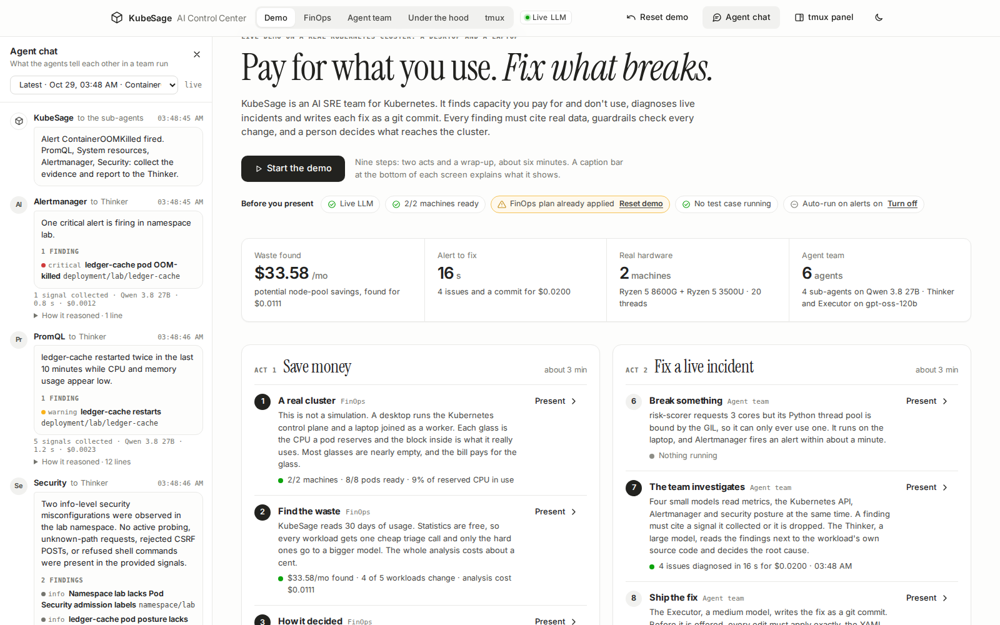
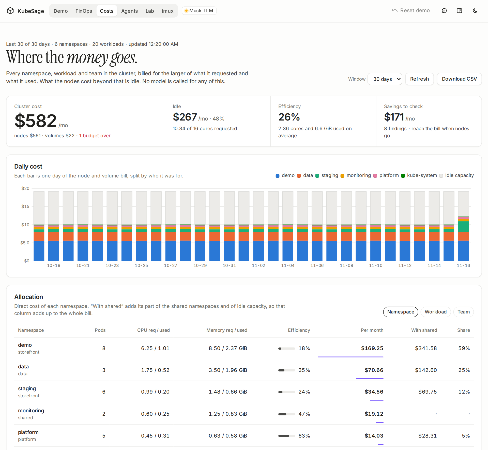
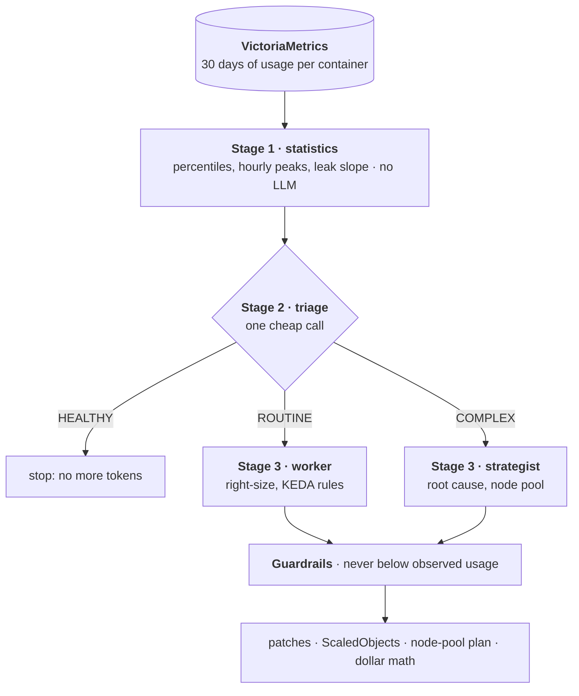
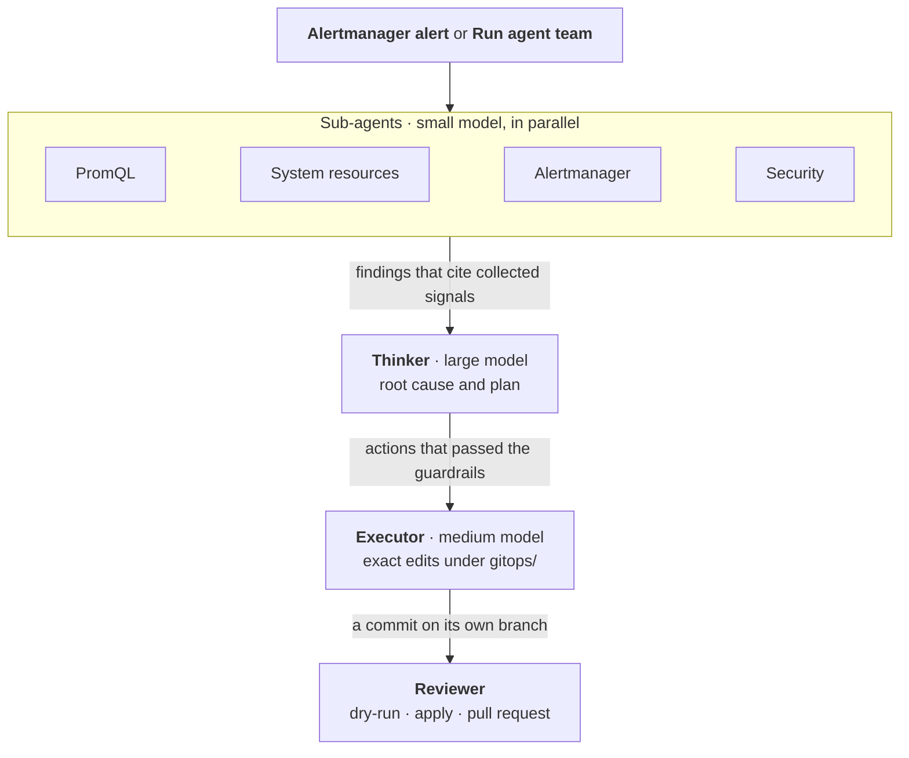
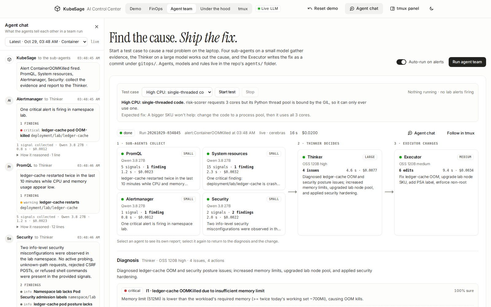
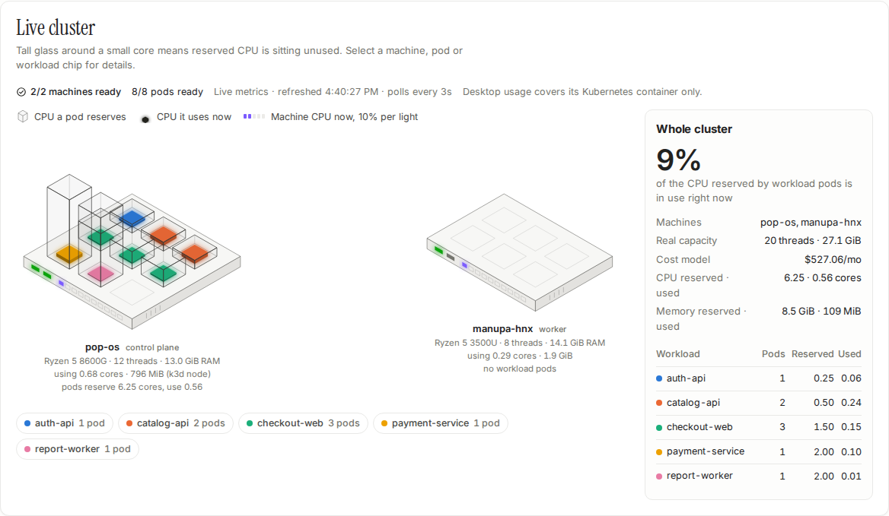

<div align="center">


# KubeSage

**An AI SRE team for Kubernetes.** It shows where the cluster's bill goes, finds the capacity you pay for and don't
use, diagnoses live incidents, and ships every fix as a reviewable git commit.

[](pyproject.toml)
[](LICENSE)
[](docs/cluster.md)
[](docs/pipeline.md)
[](docs/configuration.md)
[](https://github.com/manupawickramasinghe/kubesage/actions/workflows/tests.yml)
[](docs/testing.md)

**[▶ Demo video](demo/video/kubesage-demo.mp4)** · [Quickstart](#quickstart) · [How it works](#how-it-works) ·
[Cost allocation](#cost-allocation-where-the-money-goes) · [KubeSage and Kubecost](#kubesage-and-kubecost) ·
[Control Center](#the-ai-control-center) · [Documentation](#documentation)

<br>

<picture>
  <source media="(prefers-color-scheme: dark)" srcset="demo/screenshots/readme-demo-dark.png">
  
</picture>

</div>

## Overview

KubeSage answers three questions about a cluster:

1. **Where does the money go?** It bills every namespace, workload and team for what they reserve, shows what the
   nodes cost beyond that as idle, checks budgets, and lists what right-sizing alone never sees: abandoned
   workloads, volumes nothing mounts, cost spikes. No model is called for this.
2. **This cluster wastes money.** It reads 30 days of usage, right-sizes every workload, adds proactive KEDA
   autoscaling, picks a cheaper machine type for the node pool and shows the dollar math. Then it proves the
   right-sized cluster still scales under real traffic.
3. **Something just broke.** When an alert fires, four small-model sub-agents gather evidence, a large-model
   Thinker finds the root cause, and an Executor writes the fix as a git commit on its own branch, ready to dry-run,
   apply or open as a pull request.

It also accounts for its own bill. Every model call is metered in tokens and dollars, and a cost-aware router only
sends a workload to an expensive model when a cheap one says it needs to.

### Measured on the real cluster

The second and third were measured on a real cluster, a desktop and a laptop joined as one. Cost allocation is
newer than that cluster: it is tested against a real VictoriaMetrics with simulated history
([docs/costs.md](docs/costs.md#limits)).

| scenario | result |
|---|---|
| **Right-sizing analysis** | Node pool `D8s_v5` → `F8s_v2`: **$280.32 → $246.74 a month** at list prices (a modelled saving, not an invoice), 4 of 5 workloads changed. The analysis cost **$0.0111** in model calls |
| **Right-sizing with the business calendar** (Meta Muse, 1 November) | Reservation cost **$168.73 → $50.65 a month** (−70%). The node pool goes from 1× `D8s_v5` to 3× `F4s_v2`, **$280.32 → $370.11** (+32%), so the scheduled peaks fit; the forecast pre-warms them from `config/calendar.yaml`. The analysis cost **$0.27** in model calls, against $0.59 with every call on Muse Wonder |
| **Live incident** (`ContainerOOMKilled`) | Team run from start to diagnosis and commit in **16 s** for **$0.0200**: 4 issues, 4 actions, 3 files changed. Applying the fix and the recovery are separate steps, not included in that time |
| **Scaling under load** | In one run on the desktop, `checkout-web` scaled 2 → 7 pods, and p95 latency fell from **377 ms to ~110 ms** with zero errors |

Prices are Azure list prices: each real machine stands in for the cloud VM its `kubesage.io/sku` label names.

### Demo video

A narrated video under three minutes, made for the Meta Global AI Developer Hackathon. Slides first: what's new (FinOps and SRE in one system, scaling before the rush
from your business calendar, runs that cost cents, findings backed by evidence, a person in charge), a hypothetical
customer cluster and how KubeSage works. Then under a minute of the dashboard right-sizing that cluster with its
calendar forecast on the Meta Muse models and fixing an incident, simulated from runs recorded on the real cluster. **[Watch it](demo/video/kubesage-demo.mp4)**; the [demo folder](demo/README.md) has the chapters, the
pictures made for it, every screenshot, and how the video was made.

## Why it's different

| | |
|---|---|
| **Evidence, or it's dropped** | Every finding must cite a signal an agent actually collected. Guardrails reject actions with no evidence, unknown targets, machine types outside the catalog and requests bigger than a real node. The model gets one retry, with the reasons. |
| **Small models do the legwork** | Statistics are computed without an LLM. Cheap models triage and gather evidence; only the hard cases reach the large model. An incident run costs a few cents, and a full right-sizing analysis about one cent. |
| **People stay in charge** | The FinOps models return structured parameters, which KubeSage renders into YAML. The Executor's edits are text, so they are checked against everything their approved action may change. Agent fixes are git commits on their own branch, and no plan or fix reaches the cluster until someone presses **Apply**. The web shell is read-only and the terminal views are mirrors; test cases and **Reset demo** change the lab and demo namespaces on purpose. |

## Quickstart

Requirements: Docker and Python 3.11+. No API key is needed: without one, every model call runs in a labelled,
deterministic mock mode.

```bash
python3 -m venv .venv && .venv/bin/pip install -e '.[dev]'
docker compose up -d                  # VictoriaMetrics :8428, Grafana :3300, vmalert + Alertmanager :9193
.venv/bin/kubesage simulate           # backfill 30 days of a small shop's cluster (~2.4M samples, ~3 s)
.venv/bin/kubesage costs              # where the bill goes: namespaces, teams, idle, budgets, findings
.venv/bin/kubesage analyze            # right-size the demo namespace; writes out/<run>/report.json and manifests/
.venv/bin/kubesage serve              # the AI Control Center on http://127.0.0.1:8600
```

To call a real model, put a Meta Muse key in `.env` (gitignored) — the default profile is already
Meta, so no profile selection is needed:

```bash
echo 'MODEL_API_KEY=...' > .env   # Meta Model API key from https://dev.meta.ai
set -a; . ./.env; set +a
.venv/bin/kubesage serve          # Spark triages, Wonder handles the hard cases
```

(Cerebras also ships: `CEREBRAS_API_KEY=...` plus `KUBESAGE_MODELS=cerebras`.)

**Your key, your cluster:** any OpenAI-compatible endpoint works (copy a profile in `config/models.*.yaml`
and edit the base URL, model IDs and prices), and KubeSage reads any Prometheus/VictoriaMetrics plus your
kubeconfig — no KubeSage agent is installed in the cluster. Point it at your instance types
(`config/skus.yaml`) and your own sales calendar (`config/calendar.yaml`) and the math is yours.
[docs/getting-started.md](docs/getting-started.md) walks all three paths — no key, your key, your
cluster — with the metric series and files each one needs.

### Run it on a cluster

```bash
scripts/cluster-up.sh                 # pinned k3d + kubectl into .bin/, a k3d cluster with KEDA and the demo apps
scripts/live-up.sh                    # kube-state-metrics + vmagent: live metrics on top of the 30-day history
scripts/join-node.sh user@laptop      # optional: a second real machine joins over SSH as a k3s agent
.venv/bin/kubesage apply --dry-run    # server-side dry run of the latest analysis
.venv/bin/kubesage apply              # Deployment patches first, then ScaledObjects
.venv/bin/kubesage spike              # real CPU-heavy traffic; watch KEDA scale checkout-web out
```

Tools go to `.bin/` and the kubeconfig to `.bin/kubeconfig`; `~/.kube/config` is never touched.
`scripts/demo-reset.sh` puts the demo back in its oversized "before" state, and `scripts/cleanup.sh --check` lists
everything that's installed. [docs/cluster.md](docs/cluster.md) covers the two-machine setup and its networking,
and [docs/operations.md](docs/operations.md) is the runbook and demo-day checklist.

## How it works

### Cost allocation: where the money goes

<picture>
  <source media="(prefers-color-scheme: dark)" srcset="demo/screenshots/costs-dark.png">
  
</picture>

`kubesage costs` reads every namespace at once and follows the OpenCost convention: a pod pays for the larger of
what it requested and what it used, at the cluster's blended price per core-hour and GiB-hour, and what the nodes
cost beyond that is idle. Pods roll up to their controller, their namespace and their team. Shared namespaces and
idle capacity can be spread over the rest, which gives a "with shared" column that adds up to the whole bill.

```text
$ kubesage costs --by team
Cluster $582.24 a month: nodes $560.64, volumes $21.60. Pods are billed $293.84; $266.80 (48%) of the node bill is idle.

 team             pods  cpu req  cpu used  efficiency  $/month  with shared  share
 storefront         14     7.24      1.21         19%  $203.77      $411.31    71%
 data                3     1.75      0.52         35%   $70.66      $142.62    24%
 shared services     5     0.90      0.32         40%   $26.99            ·      ·
 platform            5     0.45      0.31         63%   $14.03       $28.31     5%

Findings · $171.29 a month in savings to check
  idle-workload   data/legacy-export           $14.47/mo   has used 0.4% of its requested CPU for a week
  unused-volume   data/orders-db-backup-2025   $16.00/mo   200 GiB, mounted by nothing
  cost-spike      staging                      $3.02 on the last day, 269% above its usual day: mostly load-test
```

Budgets per cluster, namespace and team live in [`config/costs.yaml`](config/costs.yaml); `kubesage budgets` exits
1 when one is over. `/metrics` exports the report for Grafana and Alertmanager. [docs/costs.md](docs/costs.md) has
the billing rules, the findings and the limits.

### Right-sizing: a three-stage, cost-aware router



`kubesage analyze` takes one namespace, several (`--namespace demo,staging`) or the whole cluster
(`--all-namespaces`). Workloads are found through the pod owner references the cluster exports, so a container
called `app` inside a Deployment called `checkout-web` is handled, a sidecar is left alone, and StatefulSets are
right-sized like Deployments. The node-pool plan starts from the cluster's real nodes and counts every pod the
run does not resize, so a plan for one namespace does not assume the rest of the cluster is empty.

Models return parameters, never YAML. Deterministic guardrails clamp anything below observed usage and report
every clamp, so a model can't size a pod below what it was measured using. Floors come from history, so they don't
guarantee future capacity: review a plan before applying it. Scale-to-zero is allowed only for workloads that the
statistics flag as batch jobs. The output can be applied directly or committed to your GitOps repo as a kustomize
overlay with a pull request (`kubesage gitops`). [docs/pipeline.md](docs/pipeline.md) has the details.

### Incident response: the agent team



| agent | model | what it does |
|---|---|---|
| **PromQL** | small | Container CPU, throttling, threads, memory, OOM kills, disk I/O and latency, from VictoriaMetrics |
| **System resources** | small | Nodes, pod scheduling, disk and volume usage and warning events, from the Kubernetes API and kubelet |
| **Alertmanager** | small | What is firing in Alertmanager right now |
| **Security** | small | Pod security posture, workloads created outside GitOps, RBAC, and probes against the Control Center |
| **Thinker** | large | Reads every finding plus the custom rules, finds the root causes and decides what to do |
| **Executor** | medium | Turns the plan into exact edits under `gitops/`, checked against policy before it commits |

Agents, models and plain-English platform rules are files in [`agents/`](agents/README.md): changing an agent's
model is a one-line edit. Nine live **test cases** break the lab namespace on purpose so the team has something
real to fix: high memory, CPU throttling, single-threaded code, disk I/O, a full disk, latency, Pending pods, pod
density and a hand-made insecure pod. [docs/agents.md](docs/agents.md) walks through all of it.

## KubeSage and Kubecost

[Kubecost](https://www.kubecost.com/) and [OpenCost](https://www.opencost.io/) are the reference for Kubernetes
cost visibility, and for visibility they are ahead: use them if you need what the first four rows describe.
KubeSage's bet is different. It treats the cost report as the start, and spends its effort on turning findings
into changes a person can review, and on the things a cost tool does not do at all.

| | Kubecost / OpenCost | KubeSage |
|---|---|---|
| Cost by namespace, workload and team, with idle and shared costs | Yes, and the reference for it | Yes, with the same billing rule, for CPU, memory and volumes |
| Reconciling with the cloud invoice (discounts, spot, reserved) | Yes | **No.** List prices from a catalog you edit |
| Network, load balancer and GPU costs | Yes | **No** |
| Many clusters in one view, SSO, long retention | Yes, in the paid tiers | **No.** One cluster |
| Budgets and alerts | Yes | Budgets with an exit code for pipelines and `/metrics` for your Alertmanager |
| Right-sizing | Recommendations from usage, for every workload kind | Deployments and StatefulSets, one namespace or the whole cluster: recommendations a model writes and guardrails check against 30 days of peaks, plus a node-pool plan that packs every pod on the cluster |
| Scaling ahead of known rushes | No | A business calendar (working hours, Black Friday, Christmas week) becomes KEDA triggers, with pre-warm times |
| From finding to change | Mostly yours to make | Patches, ScaledObjects and a GitOps pull request; a person applies |
| Checking its own predictions | Partly | `kubesage realized` compares what a plan promised with what the cluster now reserves |
| Incidents | No | An agent team gathers evidence, finds the root cause and writes the fix as a commit |
| Maturity | Years in production at large companies | A hackathon project: 279 tests, one small real cluster, simulated data for cost allocation |

The two can run side by side: KubeSage reads the same Prometheus and installs nothing in the cluster.

## The AI Control Center

`kubesage serve` opens a single-page app built for presenting live. It's plain HTML, CSS and JavaScript with no build
step and no CDN, and its fonts are vendored, so it works on venue Wi-Fi.

| view | what it shows |
|---|---|
| **Demo** | The pitch, live headline numbers, pre-flight checks and a nine-step run of show with a caption bar |
| **Costs** | Where the bill goes: cluster cost and idle share, a daily chart by namespace, the allocation by namespace, workload or team, budgets, nodes and findings |
| **FinOps** | Savings, an isometric drawing of the live cluster, reserved-vs-used evidence, the router's decisions and the three steps: Analyze, Apply, Send traffic |
| **Agent team** | Test cases, the sub-agents → Thinker → Executor diagram, the diagnosis and the diff |
| **Under the hood** | The pipeline stage by stage, a read-only shell, the journal, and every PromQL, LLM and `kubectl` call of a run |
| **tmux** | A read-only mirror of every terminal stream, laid out like tmux |
| **Agent chat** (left sidebar) | Each team run as the messages the agents hand each other, with each model's reasoning |
| **tmux panel** (right sidebar) | The same terminal mirror, beside any view |

<table>
  <tr>
    <td width="50%"></td>
    <td width="50%"></td>
  </tr>
  <tr>
    <td><b>Agent team.</b> The agent chat on the left shows each sub-agent's report to the Thinker, the Thinker's plan and the Executor's commit.</td>
    <td><b>Live cluster.</b> Each pod is a glass box as tall as its CPU request, with a core as tall as the CPU it uses right now.</td>
  </tr>
</table>

Every part of every view is explained in the [UI guide](docs/ui-guide.md).

## Security model

- **Read-only by default.** The web shell runs a fixed allow-list of read-only commands. The RAM ring behind the
  terminal views has no write endpoint, and nothing typed in a browser reaches a terminal.
- **Guarded writes.** Every agent edit must apply exactly, parse and stay inside its action's files. Its rendered
  result is compared with the app as it was, and any change its approved action's type may not make (an image, a
  privileged container, a host path, an extra object) is refused. Pods must stay in the lab namespace, use known
  kinds and fit one real node, checked against live node inventory: without it, nothing is accepted. Apply
  re-checks the rendered objects before it sends them. Generated code still needs a person to read it.
- **A person decides.** Agent fixes are commits on their own branches. Apply asks first; pull requests need
  `--agent-prs`.
- **Local first.** The server binds to `127.0.0.1`, and POSTs need an `X-KubeSage` header, so another site in the
  same browser can't trigger actions. Use `--host 0.0.0.0` only on a network you trust.
- **No secrets in the repo.** API keys come from the environment (`.env` is gitignored), and traces and ring dumps
  redact them.

## Configuration

| what | where |
|---|---|
| Model tiers, prices and provider | [`config/models.yaml`](config/models.yaml), or a profile `config/models.<name>.yaml` selected with `KUBESAGE_MODELS=<name>` |
| Agent team models | [`agents/models.yaml`](agents/models.yaml), one size (`small`, `medium`, `large`) per agent |
| Machine catalog and prices | [`config/skus.yaml`](config/skus.yaml) |
| Teams, shared namespaces, storage price and budgets | [`config/costs.yaml`](config/costs.yaml), see [docs/costs.md](docs/costs.md) |
| Business calendar (working hours, sales, holidays) | [`config/calendar.yaml`](config/calendar.yaml), see [docs/calendar.md](docs/calendar.md) |
| Platform rules for the agents | [`agents/rules/`](agents/rules/), plain English |

Any OpenAI-compatible endpoint works. Two profiles ship: Meta Muse (default: `muse-spark-1.3` +
`muse-wonder-1.0` on the Meta Model API) and Cerebras (`gpt-oss-120b`, `qwen-3.8-27b`). Model IDs and
prices change, so check them before relying on the cost figures. [docs/configuration.md](docs/configuration.md)
lists every environment variable.

## Command line

| command | what it does |
|---|---|
| `kubesage simulate` | Generate N days of synthetic metrics for a small cluster and backfill them |
| `kubesage costs` | Cost allocation for every namespace: by namespace, workload or team, with idle cost, budgets and findings |
| `kubesage budgets` | Check the budgets in `config/costs.yaml`; exits 1 when one is over |
| `kubesage stats` | Stage 1 only: deterministic statistics, no LLM calls |
| `kubesage analyze` | The full pipeline: stats → triage → recommendations → node pool. `--namespace a,b` or `--all-namespaces` covers more than one |
| `kubesage apply` | Apply a run's manifests (the latest by default; `--dry-run` for a server-side check) |
| `kubesage gitops` | Commit a run to a GitOps repo as a kustomize overlay, optionally opening a PR |
| `kubesage realized` | Did the saving a run promised show up? Compares its snapshot with the cluster now |
| `kubesage whatif` | Replicas and dollars for a different traffic multiplier, per calendar event or recurring peak |
| `kubesage calendar` | Draft calendar events from the metrics (`suggest`) or an `.ics` file (`import`); writes only with `--approve` |
| `kubesage serve` | The AI Control Center |
| `kubesage spike` | Send a burst of CPU-heavy traffic to a demo Service |
| `kubesage agents` | List the agent team, or run it once |
| `kubesage testcase` | Start or stop the live test cases in the `lab` namespace |
| `kubesage ring` | Read, tail or write the RAM ring that every terminal stream goes through |
| `kubesage tmux` | Open a tmux session over the ring: agents, test cases, journal and a piped ops shell |

## Repository layout

```
kubesage/            the Python package
  metrics/           PromQL client, collection, Stage 1 statistics
  llm/               schemas, prompts, OpenAI-compatible client with a cost ledger, mock tiers
  recommend/         guardrails, cost model, manifest renderer
  agents/            the team runner, guardrails, edit and policy checks
  lab/               the live test cases
  web/               the HTTP server and its API
  pipeline.py        the three-stage router
  costs.py           cluster-wide cost allocation, budgets and findings
agents/              one folder per agent (prompt, collector, model size), models.yaml, rules/
dashboard/           the Control Center: HTML, CSS and JavaScript, no build step
gitops/              the lab apps and node pools the test cases deploy and the Executor edits
config/              model profiles and the machine catalog
deploy/              Grafana, alert rules, monitoring and demo manifests
scripts/             cluster up/down, joining a machine, live metrics, demo reset, cleanup
docs/                guides, architecture, runbook, test results
tests/               pytest suite and browser checks
```

## Documentation

| guide | read it for |
|---|---|
| [UI guide](docs/ui-guide.md) | **Start here.** Every view, what each shape and number means, and how to present the demo |
| [Agent team](docs/agents.md) | Sub-agents → Thinker → Executor, test cases, alerts, the RAM ring, tmux and PRs |
| [Architecture](docs/architecture.md) | Components, data flow, design decisions and a code map |
| [Pipeline](docs/pipeline.md) | Statistics, triage and routing, guardrails, manifests and the cost model |
| [Cluster](docs/cluster.md) | The real two-machine cluster: setup, networking and what gets installed |
| [Operations](docs/operations.md) | Runbook, after a reboot, the demo-day checklist |
| [API](docs/api.md) | The HTTP API and `report.json` |
| [Testing](docs/testing.md) | The test suite, browser checks and manual checks with their last results |
| [Cleanup](docs/cleanup.md) | What `scripts/cleanup.sh` removes on each machine, and what it never touches |
| [Demo](demo/README.md) | The narrated demo video, its chapters, the slides and pictures made for it, every screenshot, and the tools that rebuild the video |
| [Project review](docs/REVIEW_REPORT.md) | The 29 October review: validation results, the findings and their status |
| [Handover](docs/HANDOVER.md) | Taking the project over: the rules, its state on 1 November, demo day, and what is still open |

## Testing

```bash
.venv/bin/python -m pytest -q                                          # 279 tests, no cluster or API key needed
.venv/bin/pip install playwright && .venv/bin/python -m playwright install chromium
.venv/bin/python tests/browser_smoke.py --output-dir /tmp/kubesage-browser   # 43 UI checks against a mocked API
```

The browser checks drive the FinOps steps, the agent team, the tmux mirror, the agent chat and the demo guide,
check layouts in light and dark mode at phone, tablet and desktop widths, and confirm that untrusted model text is
always rendered as text.

## License

[MIT](LICENSE). The vendored fonts in `dashboard/fonts/` are under the SIL Open Font License; their licence files
sit beside them.
