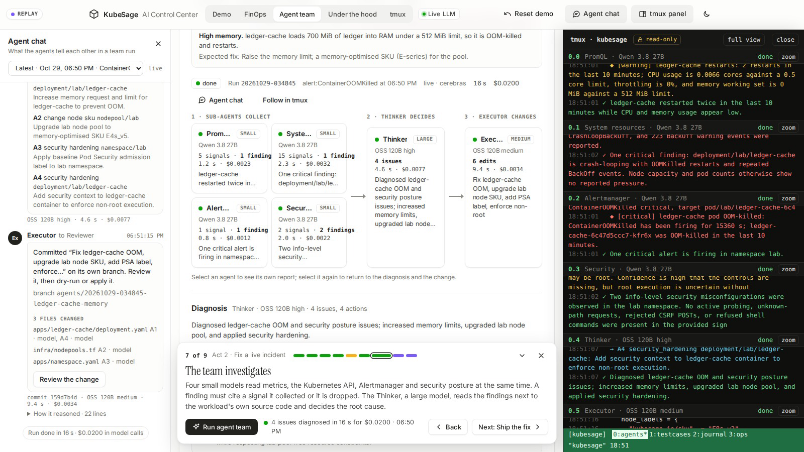

# KubeSage demo

Everything you can watch or look at: the narrated demo video, every screenshot in the docs, and the tools that
rebuild the video.

<a href="video/kubesage-demo.mp4"></a>

**[▶ Watch the demo video](video/kubesage-demo.mp4)**: 4 min 16 s, 1600×900, narrated (Kokoro voice), with English subtitles
([`kubesage-demo.srt`](video/kubesage-demo.srt)).

## What the video shows

It walks through the dashboard's own nine-step Demo mode. The caption bar at the bottom of each screen explains
the step; the voice-over explains what the numbers mean.

| time | chapter | what happens |
|---|---|---|
| 0:00 | Title | KubeSage, and what this video is |
| 0:16 | The pitch | Two stories: wasted capacity, and something that breaks |
| 0:35 | 1 · A real cluster | The desktop and the laptop; every pod a glass box as tall as its CPU request |
| 0:57 | 2 · Find the waste | Analyze: $280.32 → $246.74 a month at list prices, found for $0.0111 of model calls |
| 1:20 | 3 · How it decided | The cost-aware router and the guardrails |
| 1:38 | 4 · Apply the plan | Right-sized pods move to the laptop; report-worker scales to zero |
| 1:58 | 5 · Prove it still scales | 60 requests/s at checkout-web; KEDA scales it out to six pods |
| 2:34 | 6 · Break something | The memory test case: ledger-cache is OOM-killed and `ContainerOOMKilled` fires |
| 3:01 | 7 · The team investigates | Four sub-agents, the Thinker and the Executor, with the agent chat and the tmux panel |
| 3:27 | 8 · Ship the fix | The commit and its diff, then a dry-run apply |
| 3:54 | 9 · Why it matters | Cost, evidence and a person in charge |
| 4:09 | End | The repository |

## What is real, and what is replayed

The video is a **replay**: the real dashboard, recorded while a small local server answered its API with data
captured from the live two-machine cluster on 29 October 2026. Nothing was changed on the cluster and no model
was called while recording. A "Replay" chip in the top-left corner says so throughout.

- **Real, as recorded:** the cluster (machines, pods, requests, usage), the FinOps analysis and its model-call trace
  (run `20261029-114842-131212`), and the agent team run `20261029-034845`: every agent's report, the diagnosis,
  the commit and its diff, the cost, and the lines the agents wrote to the RAM ring, replayed at their real pace.
- **Reconstructed:** the Apply animation follows the plan (a real Apply moved the pods to the laptop on 28 October).
  The traffic step replays the recorded 60 requests/s run of 27 October from [docs/testing.md](../docs/testing.md)
  six times faster ("6× speed" chip). Its replica steps, CPU and latency follow that run's samples, and the request
  total (10,800) is its rate times its length. The test case's alert is shown firing right after the start: on the
  cluster it takes about a minute, and the team then waits 45 s for related alerts.
- **Dry-run output** in step 8 is written in the form `kubectl apply --dry-run=server` prints; nothing was sent to a cluster.

The narration was drafted by Claude, edited for clarity by **agy** (Gemini 4 Argon High), and fact-checked
read-only against the repository by **Codex**. Its corrections are in the voice-over:
[tools/narration-review.md](tools/narration-review.md).

## Folder

| path | what it holds |
|---|---|
| [`video/`](video) | `kubesage-demo.mp4`, its subtitles `kubesage-demo.srt`, and `poster.png` |
| [`screenshots/`](screenshots) | every screenshot the README and the docs use (`ui-*`, `readme-*`) |
| [`screenshots/simulation/`](screenshots/simulation) | 14 stills from the video, one per moment that matters, at full resolution |
| [`images/`](images) | the logo |
| [`tools/`](tools) | the replay server, the recorder, the voice-over and the build script, with the recorded data |

## Rebuild the video

```bash
.venv/bin/pip install playwright && .venv/bin/python -m playwright install chromium   # once
demo/tools/make_video.sh                  # ~5 minutes: voice-over, recording, encoding
```

`make_video.sh` installs [Kokoro](https://github.com/thewh1teagle/kokoro-onnx), an open text-to-speech model that
runs locally (voice `af_heart`), into `demo/tools/build/`, which git ignores. It then synthesises [`tools/narration.json`](tools/narration.json), records
the dashboard against [`tools/sim_server.py`](tools/sim_server.py) with Chrome's screencast, and encodes H.264 with
the voice and subtitles. To change what is said, edit `narration.json`; each scene is held for as long as its
narration takes. To record against new data, replace the files in [`tools/data/`](tools/data) with fresh GETs from
a running Control Center (`/api/cluster`, `/api/report`, `/api/agents`, …). They hold no secrets: the trace shows
the API key only as `$CEREBRAS_API_KEY`.
