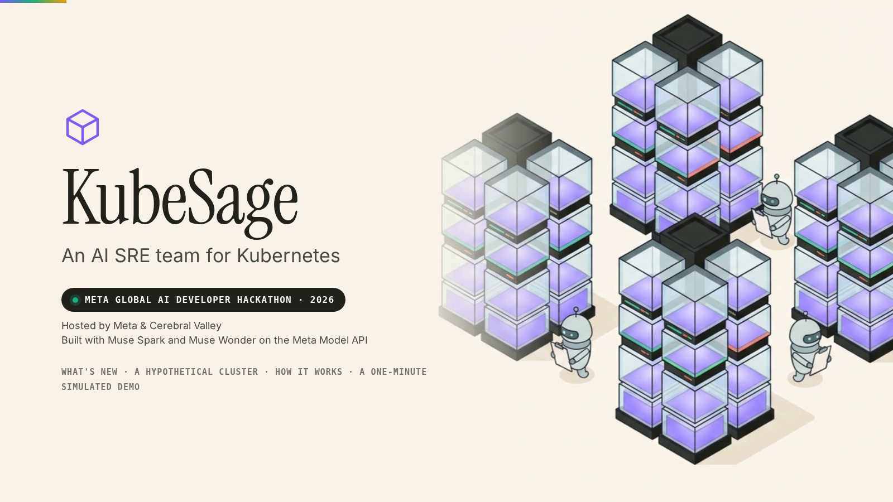

# KubeSage demo

Everything you can watch or look at: the narrated demo video, the pictures and slides made for it, every screenshot in
the docs, and the tools that rebuild the video.

<a href="video/kubesage-demo.mp4"></a>

**[▶ Watch the demo video](video/kubesage-demo.mp4)**: 2 min 53 s, 1600×900, narrated (Kokoro voice) over original music, with English subtitles
([`kubesage-demo.srt`](video/kubesage-demo.srt)).

## What the video shows

Made for the **Meta Global AI Developer Hackathon** (hosted by Meta and Cerebral Valley), which asks for a demo of
three minutes at most. A cold open (Black Friday: pay for idle servers all year, or scramble on the day?), the title,
then slides: the summary of what is new, a hypothetical customer cluster, scaling before the rush from a business
calendar, and how KubeSage finds waste and fixes incidents. Then 53 seconds of the real dashboard on that cluster, with
the camera moving to what the voice describes and the key numbers popping up, and a closing slide. The website does
not appear until the summary has been shown.

| time | chapter | what happens |
|---|---|---|
| 0:00 | Cold open and title | Black Friday triples checkout traffic: idle servers all year, or a scramble on the day? Then KubeSage, an AI SRE team for Kubernetes, built for the Meta Global AI Developer Hackathon with Muse Spark and Muse Wonder |
| 0:13 | What's new | Five points: FinOps and SRE in one system, built for the rush, cents not dollars, evidence or it's dropped, a person decides; and the results: −70% reservation cost, +32% node pool so the scheduled peaks fit, a 16 s team run |
| 0:33 | The scenario | *shop-prod*, a hypothetical online store on Azure Kubernetes: a D8s_v5 node running five services, an F8s_v2 node for test releases, a weekday-morning rush, Black Friday on the sales calendar, and a ledger cache about to ship with too little memory |
| 0:52 | Built for the rush | The business calendar (`config/calendar.yaml`) and an illustrative week of checkout traffic: the forecast pre-warms 8 pods at 08:45 on weekdays, a CPU trigger catches a flash sale, and the plan asks for a one-day Black Friday scale-up from 07:30 |
| 1:13 | Finding the waste, for cents | The FinOps pipeline: free statistics and forecast, one Muse Spark triage call, Spark for routine fixes and Muse Wonder for the hard case and the node pool, guardrails, the plan ($0.27 for the whole analysis, 55% less than all on Wonder) |
| 1:32 | How the team fixes incidents | An alert, four sub-agents, the evidence check, the Thinker and your rules, the Executor, the policy check, the commit, a person |
| 1:51 | **The website, under a minute** | The cluster · Analyze ($168.73 → $50.65/mo reservation cost, the node pool +32%, for $0.27) · the Forecast panel · Apply (the move to the new pool skipped until its nodes exist) · the bad release (`ContainerOOMKilled`) · the agent team, with its chat · the fix as a commit and its diff (16 s, $0.02) |
| 2:44 | Close | The results, the repository, how to run it yourself, and the hackathon |

## What is real, and what is hypothetical

- **Hypothetical:** the customer. *shop-prod* and its online store are a scenario for this video, and its two nodes are
  shown as the Azure VMs they would be: `aks-system-0` (D8s_v5) and `aks-lab-0` (F8s_v2).
- **Recorded, unchanged:** what KubeSage did, on the project's two-machine lab cluster, whose machines the cost model
  prices as those two VMs:
  - the FinOps analysis, run `20261101-211354-839221` of 1 November 2026, live on the Meta Muse profile
    (`muse-spark-1.3` for triage and routine workloads, `muse-wonder-1.0` for the hard case and the node pool), with the
    forecast from `config/calendar.yaml`, every recommendation and follow-up, and its model-call trace;
  - the agent-team run `20261029-034845` of 29 October, on the Cerebras profile (Qwen 3.8 27B sub-agents, gpt-oss-120b
    Thinker and Executor): every agent's report, the diagnosis, the commit and its diff, the time and the cost. The team
    slide names the default models (Muse Spark and Muse Wonder) and says this run used Cerebras.

  [tools/scenario.py](tools/scenario.py) renames the nodes, describes their hardware as the VMs', rewrites the two
  platform rules that described the lab machines, and leaves out four lines of an agent's reasoning about the lab
  hardware. Nothing else is changed.
- **Simulated:** the website part is the real dashboard answered by a small local server
  ([tools/sim_server.py](tools/sim_server.py)) with that recorded data. Nothing was sent to a cluster and no model was
  called while recording. The dashboard's header says "Simulation · hypothetical cluster" throughout. Apply plays what
  KubeSage's Apply does with this plan: the resource patches and KEDA rules land and the pods restart smaller on the same
  node, while the migrations to the planned 3× F4s_v2 pool are skipped because no node carries that label
  (`kubesage/apply.py`), so the dashboard reports 0 of 5 workloads fully matching the plan.
- **Shortened:** the recorded analysis took about a minute of model calls; the replay answers in 3 s. Apply's rollout
  plays twice as fast. The test case's alert fires 1.5 s after it starts and the team starts 0.3 s later: on a cluster the
  alert takes about a minute and the team then waits 45 s for related alerts. The team run itself plays at its recorded
  pace.
- **Illustrative:** the week of traffic on the "Built for the rush" slide is drawn to explain the idea. Its 08:45
  pre-warm to 8 pods, 1 pod off-peak, up to 10 pods on the 70% CPU target and the Black Friday scale-up from 07:30 are the
  recorded plan's. The flash sale is not part of the recording. The Black Friday scale-up is a follow-up in the recorded
  plan: the analysis was made before KubeSage rendered dated events as timed jobs.

**Sound and motion.** The voice is Kokoro (`af_heart`) at 1.15× speed. The music is an original 124 BPM track composed
in code by [tools/music.py](tools/music.py) (no samples, nothing downloaded, so no licence to clear): it builds under
the cold open, drops as the title appears, whooshes at every slide change and lifts into the website part; the build
ducks it about 13 dB under the voice while she speaks. Slides wipe in, their parts spring in sentence by sentence and
their numbers count up; on the website the camera zooms in on what the voice describes.

The voice-over was drafted by Claude, edited for clarity by **agy** (Gemini 4 Argon High) and fact-checked read-only
against the repository and the recorded data; the corrections are in it: [tools/narration-review.md](tools/narration-review.md).

## Pictures and slides

The six pictures in [`images/generated/`](images/generated) were made for the video by agy's image generator, in the
dashboard's palette, with no text in them: the title (`hero.jpg`), the store and its servers (`store.jpg`), a sale-day
rush (`rush.jpg`), the incident (`incident.jpg`), the agent team (`team.jpg`) and a person reviewing a change
(`review.jpg`); the rush picture is no longer on a slide, which shows the business calendar instead. The slides are one
HTML page, [`tools/slides/index.html`](tools/slides/index.html), with the diagrams drawn in SVG; each slide's parts
appear as the voice-over reaches them.

## Folder

| path | what it holds |
|---|---|
| [`video/`](video) | `kubesage-demo.mp4`, its subtitles `kubesage-demo.srt`, and `poster.png` |
| [`images/`](images) | the logo, and the generated pictures in `generated/` |
| [`screenshots/`](screenshots) | every screenshot the README and the docs use (`ui-*`, `readme-*`), taken from the live lab cluster |
| [`screenshots/simulation/`](screenshots/simulation) | 14 stills from the video, one per slide and per website moment, at full resolution |
| [`tools/`](tools) | the slides, the replay server and its scenario, the recorder, the voice-over, the music and the build script, with the recorded data |

## Rebuild the video

```bash
.venv/bin/pip install playwright && .venv/bin/python -m playwright install chromium   # once
demo/tools/make_video.sh                  # ~5 minutes: voice-over, recording, music, encoding
```

`make_video.sh` installs [Kokoro](https://github.com/thewh1teagle/kokoro-onnx), an open text-to-speech model that
runs locally (voice `af_heart`), into `demo/tools/build/`, which git ignores. It then synthesises
[`tools/narration.json`](tools/narration.json), records the slides and the dashboard against
[`tools/sim_server.py`](tools/sim_server.py) with Chrome's screencast, and encodes H.264 with the voice and subtitles.
To change what is said, edit `narration.json`: each scene is held for as long as its narration takes, and a slide
reveals one part per sentence. The recorder warns if the website part runs over a minute; keep the whole video under three. To record against new data,
replace the files in [`tools/data/`](tools/data) with fresh GETs from a running Control Center (`/api/cluster`,
`/api/report`, `/api/agents`, …). They hold no secrets: the trace shows the API key only as `$CEREBRAS_API_KEY`.
