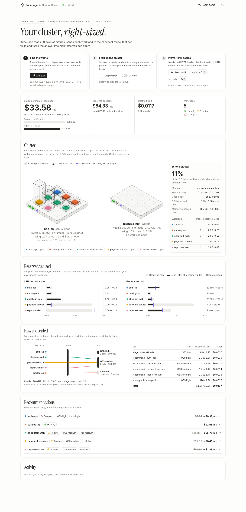
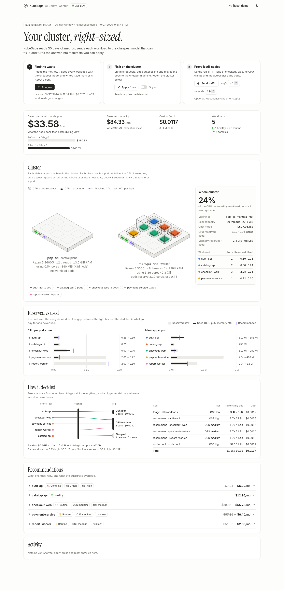
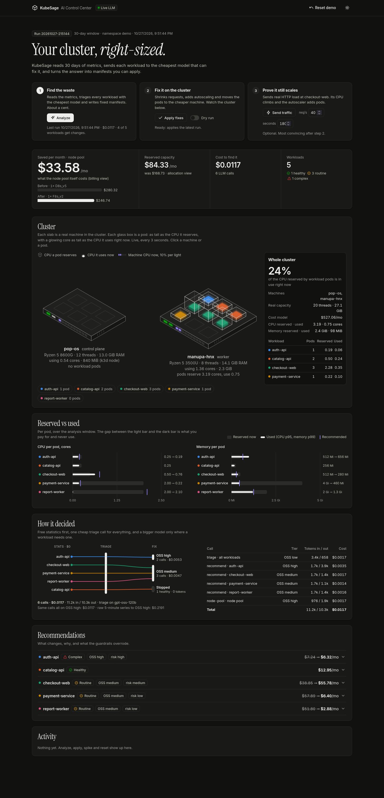
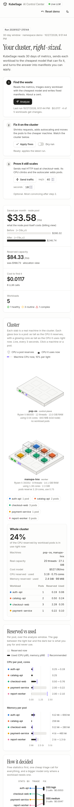

# KubeSage documentation

KubeSage finds money a Kubernetes cluster wastes and fixes it:
- right-sized requests;
- autoscaling for known peaks and for surprises;
- a cheaper machine pool.

It spends as little as possible on its own LLM calls, and shows every cent.

| document | read it for |
|---|---|
| [ui-guide.md](ui-guide.md) | **Start here.** What every part of the Control Center means, and the 3-step demo |
| [cluster.md](cluster.md) | The real cluster: 8600G desktop + 3500U laptop, networking, setup, what was installed |
| [architecture.md](architecture.md) | Components, data flow, design decisions, code map |
| [pipeline.md](pipeline.md) | Stage 1 stats and signals, triage and routing, guardrails, manifests, cost model |
| [operations.md](operations.md) | Runbook: start, after a reboot, demo-day checklist, fixes |
| [cleanup.md](cleanup.md) | Tearing it all down: what `scripts/cleanup.sh` removes on each machine, and how to check |
| [api.md](api.md) | The web server's HTTP API and `report.json` |
| [configuration.md](configuration.md) | Model profiles, SKU catalog, environment variables, secrets |
| [testing.md](testing.md) | The test suite and the manual checks, with the last verified results |
| [HANDOVER.md](HANDOVER.md) | Briefing for whoever reviews the UI/UX and tests next |

Screenshots, all taken from the live cluster:

| | |
|---|---|
|  **Before**: everything on the desktop, tall glass, small cores |  **After Apply**: everything on the laptop, right-sized |
|  **Dark mode** |  **Phone (390 px)** |
