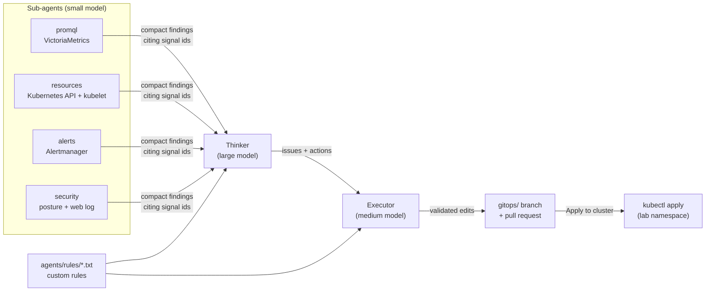

# The agent team, live test cases and the tmux view

KubeSage's second mode works like an SRE team. The right-sizing pipeline (`docs/pipeline.md`) asks "what do we
over-pay for?" over 30 days of history. The agent team asks "what is wrong right now, and what is the fix?" while
a real problem is happening on the cluster.



1. **Sub-agents** each run a `collect.py` that reads live data and records *signals*: one fact each, with an id,
   a value and the query it came from. A small model compacts the signals into a few *findings*. A finding that
   doesn't cite a collected signal is dropped.
2. The **Thinker** gets every finding, the signals they cite, the inventory (workloads, nodes, node pools from
   Terraform, the SKU catalog with prices) and the custom rules. It returns *issues* (root cause, severity,
   confidence, evidence) and *actions* (set_resources, change_node_sku, code_change, autoscale, storage,
   security_hardening, ...). Guardrails reject what is unsupported: an issue without evidence, an action on a
   target that doesn't exist, a SKU outside the catalog, or requests or limits bigger than today's nodes. When
   something is rejected, the Thinker gets one retry with the reasons.
3. The **Executor** gets the actions and the current text of every file they touch, and returns find/replace
   edits plus a PR title and body. Each edit must match its file exactly once and leave it valid: YAML parses
   without duplicate keys, `kubectl kustomize` builds the app, Python compiles, and every Terraform `vm_size` is
   in `config/skus.yaml`. Edits that fail are dropped and listed. When all the model's edits for a structured
   action fail, KubeSage's rule-based executor writes that action instead, and the PR labels those edits
   `rules-fallback`. The edits are committed to a fresh branch in the Executor's own clone (`out/agents/repo`),
   never in the checkout the server runs from.

Without an API key every role has a deterministic stand-in: the same real signals and inventory, rule-based
judgement. Runs and PRs say `mock` when that happened.

## The agents/ folder

Everything about the agents is data in the repo's top-level `agents/` folder; the engine in `kubesage/agents/`
loads whatever is there. See [agents/README.md](../agents/README.md) for adding an agent.

| path | what |
|---|---|
| `agents/models.yaml` | Profiles (`cerebras`, `meta`) and what `small`, `medium` and `large` mean in each. `KUBESAGE_MODELS` picks the profile. |
| `agents/rules/*.txt` | Custom rule sets in plain English. Given verbatim to the Thinker and Executor on every run. |
| `agents/<name>/agent.yaml` | `name`, `role`, `model` (a size), `settings`, `enabled`, `order` |
| `agents/<name>/prompt.md` | The instructions; the engine appends the JSON contract for the role |
| `agents/<name>/collect.py` | Sub-agents: `collect(ctx)`. `ctx` reads PromQL, the Kubernetes API, Alertmanager, `gitops/` and the Control Center's request log, all read-only |

With `KUBESAGE_MODELS=cerebras`, the sub-agents run `qwen-3.8-27b` and the Executor and Thinker run
`gpt-oss-120b` at medium and high reasoning effort. A team run on the memory test case cost $0.024–0.027 and took
about 15 s (live, 28 Oct 2026). The Meta profile maps small/medium/large to Glimmer/Spark/Wonder, whose IDs are
still unverified.

### What the rules changed, live

`agents/rules/platform.txt` ships with rules about the demo platform. Two of them visibly steer the agents:
- *ledger-cache grows to about 20 GiB at month end; never shrink the cache.* With this rule the Thinker raised
  the memory limit **and** moved the lab pool from F8s_v2 to a memory-optimised E-series SKU. Without it, it
  only raised the limit.
- *Enforce Pod Security baseline, not restricted, until the lab images are rebuilt.* An earlier run without
  this rule proposed `restricted`, which would have blocked every lab workload.

## Live test cases

Each test case deploys a real workload into the `lab` namespace on the lab pool (the 3500U laptop,
`kubesage.io/pool=lab`) that causes one kind of problem. The workloads are in `gitops/apps/<app>/`, the same
files the Executor edits. Start and stop them from the Lab's dropdown, the tmux view, or
`kubesage testcase start|stop <name>`.

| test case | workload | what happens on the cluster | the fix the agents should find |
|---|---|---|---|
| `memory` | ledger-cache | Loads 700 MiB into RAM under a 512 MiB limit: OOM-killed, restarts, CrashLoopBackOff | Raise the limit; with the month-end rule, a memory-optimised SKU |
| `cpu-throttle` | render-farm | 4 CPU-bound processes under a 1-core limit: throttled most periods | More cores; a compute-optimised SKU if the pool is short |
| `cpu-code` | risk-scorer | Requests 3 cores, but a Python thread pool under the GIL uses exactly one | Not a bigger SKU: change `ThreadPoolExecutor` to `ProcessPoolExecutor`, then it uses all 3 |
| `disk-io` | log-shipper | 20 MB/s of fsynced 256 KiB writes to local disk | Faster storage (a rule forbids batching the fsyncs) |
| `disk-full` | media-cache | Fills its 1 GiB emptyDir to 950 MiB and never evicts | Eviction in the code, or a bigger volume, before kubelet evicts the pod |
| `latency` | api-gateway | A load Job sends 25 req/s of 30 ms CPU work to a 0.3-core pod; p95 climbs past 500 ms | More CPU, and KEDA autoscaling |
| `pod-count` | batch-fanout | 12 replicas × 1 core on an 8-core node: several stay Pending | The pods use ~0 CPU: cut the requests rather than buy nodes |
| `pod-density` | sidecar-swarm | 80 tiny pods on one node (max 110) | Raise max_pods, or spread and consolidate |
| `security` | debug-tools | A bare Pod created outside GitOps: busybox:latest, root, no limits | Flag the drift; enforce Pod Security on the namespace; a human removes the pod |

### Verified live (28 Oct 2026, Cerebras profile)

Every test case was run on the real cluster, and every alert above fired. The agent team's answers:
- **cpu-code** (auto-run by the `ContainerCPUBusy` alert): the Thinker read the source and blamed the GIL; the
  Executor swapped the thread pool for a process pool. Applied with **Apply to cluster**, risk-scorer went from
  ~1.0 to **2.99 cores** and from 2.4M to **6.4M transactions/s**. The PR it opened (#12) was then closed
  unmerged so the test case still works.
- **memory**: raised the limit and, because of the month-end rule, moved the lab pool from F8s_v2 to E4s_v5
  in Terraform.
- **cpu-throttle, disk-io, disk-full, latency, security** at the same time: 4 issues, 5 actions, every edit
  written by the model and valid, in 15 s for $0.035. The hand-made pod went to a human (`investigate`).
- **latency**: callers saw a 29 s p95 while the app's own histogram said under 0.5 s. The load generator
  measures client-side latency for exactly this reason.
- **pod-count**: cut each replica's request to 500m so all 12 fit, rather than adding a node.
- **pod-density**: added a KEDA ScaledObject for sidecar-swarm (a new file, plus the kustomization entry).

Model output varies from run to run. These are single runs, not guarantees; the guardrails and validation are
what make every run safe to apply.

Every test case is bounded: memory stays under its container limit, CPU under its limit, disk writes under
1 GiB of space, and the pause-image pods use a few MiB each. Run one at a time; the laptop also runs Pi-hole
and GitHub runners. **Merging an Executor PR fixes a test case for good**, because test cases deploy from
`gitops/`. To repeat a demo, close the PR rather than merging it.

## Alerts

`docker compose up -d` also starts **vmalert** (`:8880`), which evaluates `deploy/alerts/rules.yml` against
VictoriaMetrics, and **Alertmanager** (`127.0.0.1:9193`; 9193 because 9093 is often taken by another
Alertmanager). The rules are generic symptoms (memory near limit, OOM kills, throttling, busy CPU, heavy disk
writes, a nearly full volume, p95 latency, Pending pods, pod density, unmanaged pods); none names a test case.

While `kubesage serve` runs it:
- polls Alertmanager every 10 s, writes new lab alerts to the journal and the ring, and, with **Auto-run on
  alerts** on, runs the team 45 s after the first new alert, so related alerts can fire too (at most one
  auto-run every 3 minutes);
- copies kubelet's `/stats/summary` disk numbers into VictoriaMetrics every 15 s
  (`kubesage_pod_volume_used_bytes` and friends, `kubesage/kubestats.py`), because cAdvisor doesn't report
  emptyDir usage.

## The RAM ring and the tmux view

All terminal output goes through one fixed-size ring buffer in RAM: `/dev/shm/kubesage-ring`, 500 MiB by default
(`KUBESAGE_RING_MB`, `KUBESAGE_RING`). It is a sparse file, so it only takes RAM as it fills, and when it's full
the oldest 1 MiB segment is overwritten. It survives server restarts, but not a reboot. The streams are:

| stream | written by |
|---|---|
| `agent/<name>`, `agent/team` | each agent as it works: signals over threshold, findings, model calls with tokens and cost, the reasoning text the model returned, edits, the diff |
| `testcase/<name>` | starting and stopping a test case, and the test case pods' own logs (`kubectl logs -f`) |
| `watch/pods`, `watch/events` | `kubectl get pods,events -n lab -w`, run by the server |
| `alerts` | new Alertmanager alerts |
| `journal`, `access` | the Lab's journal, and Control Center requests that got a 403 or 404 or a refused shell command |
| `tmux/<pane>` | panes of a real tmux session piped in with `tmux pipe-pane` |

**The tmux view** (header → tmux) shows the ring as tmux windows (`agents`, `testcases`, `journal`, `ops`). It
is a read-only mirror. The web can read the ring (`GET /api/ring`, `/api/ring/stat`, `/api/ring/dump`) but no
endpoint writes to it, and nothing typed in a browser reaches a terminal. **save** downloads the last 5 minutes,
30 minutes or the whole ring as a text file, with API key values redacted.

**A real tmux session** on the server: `kubesage tmux` opens session `kubesage` with the same windows, each pane
running `kubesage ring tail -f --streams ...`, plus an `ops` window with a normal shell. That shell's output is
piped into the ring (`tmux pipe-pane -O 'kubesage ring write --stream tmux/ops'`, escape codes stripped), so
what the presenter types at the desk shows up in the web view, as text only. `scripts/install-tools.sh` fetches
a tmux binary into `.bin/` without sudo if the machine has none.

```bash
kubesage ring tail -f --streams 'agent/*'      # follow every agent
kubesage ring dump --minutes 30 > demo.log     # keep a slice of the demo
kubesage ring stat
```

## Pull requests

The Executor always commits to a local branch `agents/<run-id>-<target>-<category>` in `out/agents/repo`, a clone of
this repo's `origin`, starting from `origin/main` (`KUBESAGE_AGENTS_BASE` or the executor's `settings.base_branch`
overrides it). Opening a pull request is separate and opt-in:
- start the server with `--agent-prs`, then press **Open pull request** on a run; or
- set `auto_pr: true` in `agents/executor/agent.yaml` (with `--agent-prs`) to open one on every run that
  commits; or
- `kubesage agents run --open-pr`.

PRs are opened with `gh` as whoever is logged in, against this repo's `origin` (the public kubesage repo).
**Apply to cluster** runs `kubectl apply -k` for each changed `gitops/apps/<app>` from the Executor's commit
(**Dry-run apply** adds `--dry-run=server`). Terraform changes in `gitops/infra/` are never applied: the home
lab can't change its hardware, and `terraform apply` against Azure is a person's job.

## Security

What the security sub-agent can see, all read-only:
- pod posture (root, privilege, capabilities, host namespaces and paths, floating tags, unapproved registries,
  no limits);
- drift: lab workloads that aren't in `gitops/`, and which tool wrote them (`managedFields`);
- namespaces without Pod Security labels, and RoleBindings to powerful roles;
- the Control Center's own request log: unknown paths (scanners), POSTs rejected for a missing CSRF header,
  and commands the lab shell refused, grouped by client address.

It can't see process activity inside containers, network flows, or kube-apiserver audit logs. That would need
Falco or an API server audit policy; neither is installed.

The web UI has no login. Anyone on the network can start test cases, run the team and press Apply (for the lab
namespace only). The ring and the tmux view are read-only, and the lab shell stays read-only.
