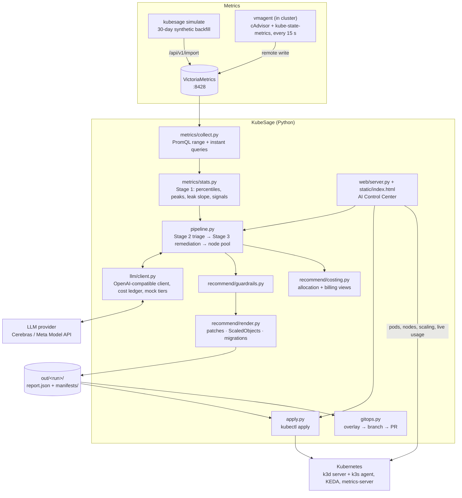
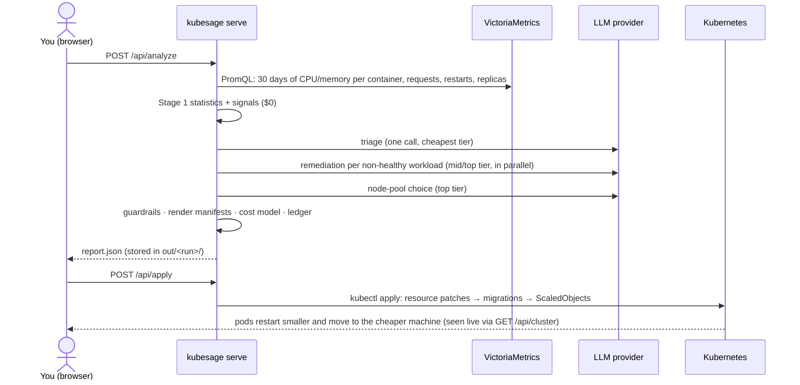

# Architecture

KubeSage is a Python package with a CLI (`kubesage …`) and a web UI (`kubesage serve`). Both are built on the
same blocks:

1. read metrics from a Prometheus-compatible TSDB;
2. reduce them to statistics;
3. ask LLMs, as cheaply as possible, what to change;
4. clamp the answers with deterministic guardrails;
5. render Kubernetes manifests;
6. apply them, or open a GitOps PR.

## Components

## What one Analyze → Apply does

## Design decisions

- **Models return parameters, not YAML.** Every LLM call returns a pydantic-validated JSON object: requests,
  limits, min/max replicas, cron windows, a CPU target. YAML is rendered by code. A malformed answer is
  retried once, then fails loudly.
- **Guardrails are deterministic and visible.** Requests never go below observed usage, scale-to-zero only for
  batch workloads, peaky workloads keep a CPU trigger. Every override is recorded and shown in the UI and the
  report. Two of these rules came from real model answers in live runs (see [pipeline.md](pipeline.md)).
- **Cheap first.** Stage 1 is free arithmetic. One triage call covers all workloads. Only workloads triage marks
  as needing work reach the bigger tiers. Every call is in a ledger with its token counts and price.
- **Mock mode.** Without an API key the pipeline runs with deterministic stand-ins and estimated token counts,
  so tests and offline demos work. The UI says "Mock LLM" when that's the case.
- **The web UI is stdlib.** `http.server` plus one HTML file with inline CSS/JS and vendored fonts. There is no
  build step and no CDN, so it works on bad venue Wi-Fi. POSTs need an `X-KubeSage: 1` header, which a
  cross-origin page can't send without a CORS preflight this server never answers.
- **Real cluster, modelled prices.** The UI shows real machines and live usage. Dollar figures come from the SKU
  catalog, each machine standing in for a cloud VM through its `kubesage.io/sku` label.

## Code map

| path | what it does |
|---|---|
| `kubesage/cli.py` | `simulate`, `stats`, `analyze`, `apply`, `gitops`, `serve`, `spike`, `ring`, `tmux`, `agents`, `testcase` |
| `kubesage/config.py` | loads `config/models[.<profile>].yaml` and `config/skus.yaml` |
| `kubesage/simulate/` | the five demo scenarios as curves, and the VictoriaMetrics backfill |
| `kubesage/metrics/` | PromQL client, collection (skips workloads with under an hour of samples), Stage 1 stats |
| `kubesage/llm/` | schemas, prompts, the client with retries and ledger, mock answers |
| `kubesage/pipeline.py` | the router: triage → remediation → guardrails → cost → node pool |
| `kubesage/recommend/` | guardrails, cron subset, cost model, manifest renderer |
| `kubesage/apply.py` | plans and runs `kubectl apply` for a run's manifests |
| `kubesage/live.py` | the `loadgen` Job behind `kubesage spike` / Send traffic |
| `kubesage/gitops.py`, `summary.py` | kustomize overlay + PR, and its markdown report |
| `kubesage/service.py` | collect + analyze + persist, shared by the CLI and the web server |
| `kubesage/web/server.py` | HTTP API (see [api.md](api.md)) |
| `kubesage/web/static/index.html` | the whole UI: HTML, CSS, JS, SVG diagrams |
| `deploy/k8s/demo/` | the five demo Deployments and their tiny Python app |
| `deploy/k8s/monitoring/` | kube-state-metrics + vmagent |
| `deploy/grafana/` | Grafana provisioning and the "requested vs used" dashboard |
| `scripts/` | pinned tools, cluster up/down/reset, live metrics, join/leave a machine |
| `agents/` | the agent team's definitions, prompts, collectors, models and custom rules (see [agents.md](agents.md)) |
| `kubesage/agents/` | the team engine: loader, context, schemas, orchestration, edit validation, the Executor's clone |
| `kubesage/lab/` | the live test cases (start/stop/status) and the out-of-band security test manifest |
| `kubesage/ring.py` | the RAM ring buffer behind the tmux view and `kubesage ring` |
| `kubesage/kubestats.py` | copies kubelet's disk numbers into VictoriaMetrics |
| `kubesage/web/team_api.py` | the team, test-case and ring endpoints; alert watcher; lab log followers |
| `gitops/` | the test cases' workloads and the node-pool Terraform that Executor PRs edit |
| `deploy/alerts/` | vmalert rules + Alertmanager config |
| `tests/` | pytest suite (see [testing.md](testing.md)) |
