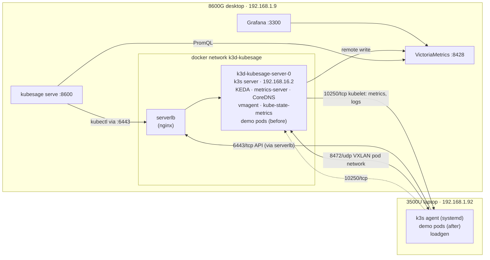

# The demo cluster: two real machines

The demo runs on two physical machines on the same LAN:

| | Ryzen 5 8600G desktop | Ryzen 5 3500U laptop |
|---|---|---|
| hostname | `pop-os` | `manupa-hnx` |
| LAN IP | 192.168.1.9 | 192.168.1.92 |
| OS | Pop!_OS 24.04 LTS | Ubuntu 26.04.1 LTS |
| CPU / RAM | 6 cores, 12 threads / 13 GiB | 4 cores, 8 threads / 14 GiB |
| Kubernetes role | control plane, k3s **inside a k3d container** | worker, **native k3s agent** (systemd) |
| node name | `k3d-kubesage-server-0` | `manupa-hnx` |
| also runs | VictoriaMetrics + Grafana (docker compose), `kubesage serve`, Frigate and other services | Docker services (Pi-hole, GitHub runners, …) |
| pool label `kubesage.io/sku` | `D8s_v5`, the "current, expensive" pool | `F8s_v2`, the "cheaper" pool (the catalog SKU closest to 8 threads / 14 GiB) |

Both run k3s **v1.36.4+k3s1**. The demo workloads start on the desktop. When the analysis picks the laptop's
pool, `apply` moves them across.

## Topology



Published on the desktop's LAN IP, all by Docker, so they bypass the desktop's ufw:

| port | to | why |
|---|---|---|
| 6443/tcp | serverlb → k3s API server | kubectl, the agent, and pods on the laptop reaching `kubernetes.default` |
| 8472/udp | server node | flannel VXLAN: pod-to-pod traffic between the machines |
| 10250/tcp | server node's kubelet | metrics and logs when asked for from the laptop side |

## How the networking works, and the two traps

The server is a container on a Docker bridge (192.168.16.0/20), so the laptop can't reach its real IP. Three
settings make it reachable anyway:

1. **`--node-external-ip=192.168.1.9`** on the server. k3s then advertises the API at 192.168.1.9:6443, which
   becomes the endpoint of the `kubernetes` Service, so pods on both machines can reach the API.
2. **`--flannel-external-ip`**: flannel uses the external IPs as VXLAN tunnel endpoints. The laptop sends
   VXLAN to 192.168.1.9:8472, Docker forwards it into the server container, and the server's replies leave
   through Docker's NAT with 192.168.1.9 as the source address.
3. **Infrastructure pinned to the server.** KEDA, metrics-server, CoreDNS, vmagent and kube-state-metrics have a
   `node-role.kubernetes.io/control-plane` nodeSelector. vmagent must sit next to VictoriaMetrics' Docker
   network, and the cluster keeps working while the laptop sleeps.

**Trap 1: ping works, TCP and UDP don't.** With checksum offload on, VXLAN packets that go through Docker's NAT
arrive with TCP/UDP checksums the receiver drops, while ICMP gets through. DNS and HTTP from a laptop pod to a
desktop pod time out, but ping works. The fix is to compute checksums in software on both ends:

```bash
ethtool -K flannel.1 tx-checksum-ip-generic off
```

- The laptop gets it from a udev rule, `/etc/udev/rules.d/90-kubesage-flannel.rules`, so it survives reboots
  and k3s restarts. This is verified.
- The desktop's `flannel.1` lives inside the k3d container and is recreated when that container restarts.
  `cluster-up.sh`, `join-node.sh` and `live-up.sh` all re-apply the fix, so after a reboot run
  `scripts/live-up.sh`.

**Trap 2: the desktop's IP is baked in.** The kubeconfig (`https://192.168.1.9:6443`), the API certificate, the
external IP and the agent's join URL all use 192.168.1.9. If DHCP hands the desktop a different address,
recreate the cluster, or reserve the IP on the router (recommended).

## Set it up from scratch

On the desktop, in the repo:

```bash
docker compose up -d                                    # VictoriaMetrics + Grafana
.venv/bin/kubesage simulate                             # 30-day history (deletes old demo series first)
NODE_IP=192.168.1.9 scripts/cluster-up.sh               # LAN-joinable server, KEDA, demo workloads ("before")
scripts/live-up.sh                                      # vmagent + kube-state-metrics -> VictoriaMetrics
scripts/join-node.sh manupa@192.168.1.92                # laptop joins as a worker, labelled F8s_v2
```

`join-node.sh` needs key-based SSH to the laptop. It asks for the laptop's sudo password, or reads
`SUDO_PASSWORD`, and sends both the password and the join token over SSH's stdin, never on a command line. On
the laptop it:

- installs the pinned k3s agent with the official installer (`--node-ip`/`--node-external-ip` = its LAN IP);
- writes the VXLAN udev rule and applies the fix;
- adds ufw rules for 10250/tcp and 8472/udp from the desktop only, if ufw is active (on this laptop it isn't).

Back on the desktop, it waits for the node to be Ready, then labels and annotates it: `kubesage.io/host`,
`kubesage.io/cpu` and `kubesage.io/os`, which the UI shows.

Check it:

```bash
export KUBECONFIG=$PWD/.bin/kubeconfig PATH=$PWD/.bin:$PATH
kubectl get nodes -L kubesage.io/sku -o wide
kubectl top nodes
kubectl -n demo run nettest --rm -i --restart=Never --image=python:3.13.12-alpine3.22 \
  --overrides='{"spec":{"nodeName":"manupa-hnx"}}' --command -- \
  python -c 'import socket; print(socket.gethostbyname("checkout-web.demo.svc.cluster.local"))'
```

## What was changed on each machine

**Laptop (192.168.1.92)**, via `join-node.sh`:

- `/usr/local/bin/k3s` and its symlinks `kubectl` and `crictl`;
- `k3s-killall.sh` and `k3s-agent-uninstall.sh` in `/usr/local/bin`;
- `/etc/systemd/system/k3s-agent.service` and `k3s-agent.service.env`, which holds the join token, root-only;
- the service is enabled and starts at boot;
- `/etc/udev/rules.d/90-kubesage-flannel.rules`;
- k3s state in `/var/lib/rancher/k3s` and `/etc/rancher`, plus `flannel.1` and `cni0` interfaces and k3s'
  iptables chains.

No ufw rules were added (ufw is inactive there). Docker and its containers are untouched.

**Desktop (192.168.1.9)**: only Docker objects. These are the k3d containers `k3d-kubesage-server-0` and
`k3d-kubesage-serverlb`, the `k3d-kubesage` network, and the three published ports above. The kubeconfig is in
the repo at `.bin/kubeconfig`; `~/.kube/config` is untouched.

## Day two

| situation | what happens / what to do |
|---|---|
| Laptop asleep or off | Its node goes NotReady after ~40 s. Infrastructure is on the desktop, so the UI keeps working. Pods on the laptop come back when it wakes. |
| Laptop reboots | The k3s agent starts at boot and the udev rule re-applies the VXLAN fix. Nothing to do. |
| Desktop reboots | Docker restarts the k3d containers, VictoriaMetrics and Grafana. Run `scripts/live-up.sh` (re-applies the VXLAN fix) and start `kubesage serve`. |
| Run the demo again | **Reset demo** in the UI, or `scripts/demo-reset.sh` |
| Remove the laptop | `scripts/leave-node.sh manupa@192.168.1.92`: drains the node, deletes it, uninstalls k3s and removes the udev rule |
| Start over | `scripts/cluster-down.sh`, then the setup above |
| Desktop IP changed | `scripts/leave-node.sh …`, `scripts/cluster-down.sh`, then setup with the new `NODE_IP` |

## Troubleshooting

| symptom | check |
|---|---|
| Laptop pod can't resolve DNS, but `ping` across works | The VXLAN checksum trap. Run `ethtool -k flannel.1 \| grep tx-checksum-ip-generic` on the laptop and `docker exec k3d-kubesage-server-0 ethtool -k flannel.1` on the desktop; both should say `off`. `scripts/live-up.sh` fixes the desktop side. |
| `kubectl top` misses the laptop | `kubectl -n kube-system logs deploy/metrics-server`. The desktop must reach 192.168.1.92:10250. |
| Laptop node NotReady | On the laptop, `systemctl status k3s-agent` and `journalctl -u k3s-agent -n 50`. It must reach 192.168.1.9:6443. |
| Pods stay on the desktop after Apply | The analysis picked a pool no machine is labelled with; `apply` skips migrations then. See `kubectl get nodes -L kubesage.io/sku` and the run's `node_pool.choice.sku`. |
| Analysis fails with "no workloads found" | VictoriaMetrics has no demo history: `kubesage simulate`, then `scripts/live-up.sh`. |

## One machine instead

`TWO_NODE=1 scripts/cluster-up.sh` (without `NODE_IP`) adds a second k3d container on the same desktop,
labelled `F4s_v2`. Pods "migrate" between two containers on one host. It's useful without the laptop, but
both nodes are the same hardware.
