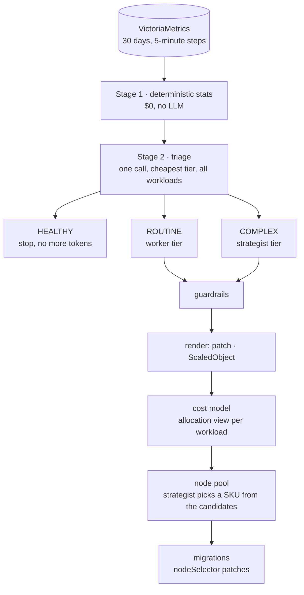

# The analysis pipeline

## Stage 1: statistics

`metrics/collect.py` queries per container:

- CPU per pod, max and total across pods;
- memory working set;
- restarts;
- requests and limits (from kube-state-metrics);
- replicas.

Workloads with **under an hour of samples are skipped**: a debug pod or a just-deployed workload has no history
worth analysing, and one used to abort the whole run. `metrics/stats.py` reduces each workload to a compact
record:

- CPU per pod: p50/p95/p99, and the active-period median;
- memory per pod: p50/p95/p99/max, and the active-period p95;
- weekday and weekend hourly CPU profiles;
- **recurring peaks**: days, hours, size, and how often they recur;
- **memory growth** in MiB/day, measured between restarts;
- restarts, the share of time active, and the time spent over the CPU request.

It also attaches **signals**, the deterministic tags triage sees:

| signal | rule |
|---|---|
| `no-requests` | no CPU or memory request |
| `cpu-overprovisioned` | CPU p95 < 40% of the request |
| `mem-overprovisioned` | memory p99 < 50% of the request |
| `mem-over-request` | memory p95 > request |
| `cpu-over-request` | over the CPU request > 2% of the time |
| `batch-pattern` | active < 25% of the time and idle median < 5% of the active median |
| `recurring-peak` | Stage 1 found a peak that recurs on most matching days |
| `memory-growth` | grows > 2% of the limit (or request, or max) per day |
| `oom-restarts` / `restarts` | restarts, with memory at ≥ 95% of the limit, or not |

## Stage 2: triage

One call to the **triage tier** gets every workload's record and returns HEALTHY, ROUTINE or COMPLEX with a
one-line summary for each. Healthy workloads stop there. If the model leaves a workload out, a deterministic
triage fills it in, and a note says so.

## Stage 3: remediation

Each non-healthy workload goes, in parallel, to the **worker** tier (ROUTINE) or the **strategist** tier
(COMPLEX). The model returns a `Recommendation`:

- diagnosis, risk, follow-ups;
- `resources`: CPU/memory requests and limits;
- `scaling`: min/max replicas, cron windows (`start`/`end` in a cron subset) with desired replicas, an optional
  CPU utilisation target.

## Guardrails (`recommend/guardrails.py`)

Applied to every recommendation, with every override recorded:

| rule | why |
|---|---|
| Invalid cron windows are dropped | the renderer only supports a cron subset |
| **min replicas 0 is allowed only with the `batch-pattern` signal**; otherwise raised to cover the median load | found live: the model put checkout-web, a web frontend, on scale-to-zero |
| **Workloads with `recurring-peak` or `cpu-over-request` keep a CPU trigger** (70%), and max > min | found live, twice: cron-only scaling for checkout-web, so a traffic spike never added pods |
| Scale-to-zero drops the CPU trigger | KEDA can't wake a workload from zero on CPU |
| min 0 with no cron window → 1 | nothing would wake it |
| max replicas ≤ 20; cron replicas within [min, max]; CPU target within 30–95% (each change noted) | sanity |
| CPU request ≥ the 30-day median (active-period median for scale-to-zero) | never starve a pod |
| memory request ≥ the median (active p95 for scale-to-zero); limit ≥ 1.15 × observed max and ≥ request | never OOM-kill on day one |
| CPU limit ≥ the request and the p99 | no throttling below observed load |
| **The replicas a plan can reach × CPU per pod (limit, else request) ≥ the p95 total across pods**: else a CPU trigger is added and max raised, or cron windows raised for scale-to-zero; min covers the median total; with fixed replicas the CPU limit covers its share | per-pod floors don't protect a replica cut: four pods using 0.8 cores could become one pod capped at 0.25 |

## Rendering (`recommend/render.py`)

For each workload with a recommendation:

- `<name>.patch.yaml`: a strategic-merge patch of the Deployment's container resources. With a ScaledObject,
  it also sets `replicas: null`, so Git and the HPA don't fight.
- `<name>.keda.yaml`: a KEDA ScaledObject with `cron` triggers (timezone from `--tz`) plus a `cpu` trigger
  (`Utilization`).
- `<name>.migrate.yaml`: when the node pool changes, a nodeSelector patch to `kubesage.io/sku=<chosen SKU>`.

`apply` runs patches, then migrations, then ScaledObjects. It skips a migration when no node carries the target
label, so pods never end up Pending.

## Cost model (`recommend/costing.py`, `config/skus.yaml`)

- **Unit prices** come from the reference SKU (D4s_v5), assuming 1 vCPU costs as much as 7.5 GiB:
  `core_h = hourly / (vcpu + GiB/7.5)` and `GiB_h = core_h / 7.5`.
- **Allocation view** per workload: `(cpu_request × core_h + mem_GiB × GiB_h) × replicas × 730 h`. After a
  change, replicas are the week's expected average from the cron windows; CPU-triggered scale-out isn't
  modelled.
- **Billing view**: for the demand after the changes, every SKU that fits the largest pod is a candidate, with
  `nodes = max(min_nodes, ⌈cpu / (vcpu × 0.9)⌉, ⌈mem / (GiB × 0.8)⌉, packed)`, where `packed` places every pod
  first-fit-decreasing onto nodes of that SKU (four 2-core pods need four 3.6-core nodes, not three). The burst
  warning uses the same packing. It doesn't model other namespaces' pods or taints. The strategist picks one, given the
  candidates and which workloads have sustained load. Burstable B-series is a poor fit for those. An invalid
  pick falls back to the deterministic choice.
- **Before** = `current_pool` in `skus.yaml`: 1× D8s_v5, matching the real desktop.

Live run 20261027-215621 (Cerebras, `gpt-oss-120b` low/medium/high):

| workload | triage → tier | change | $/mo before → after |
|---|---|---|---|
| auth-api | COMPLEX → strategist | memory leak: limit up as a stopgap, fix in code | 7.24 → 6.33 |
| catalog-api | HEALTHY | none | 12.95 |
| checkout-web | ROUTINE → worker | CPU 1200m, KEDA 1–3, cron 08:50–11:00 weekdays + CPU 70% (guardrails: min 0→1, CPU trigger added) | 38.85 → 31.90 |
| payment-service | ROUTINE → worker | 2 CPU / 4 GiB → 220m / 456Mi | 57.89 → 6.38 |
| report-worker | ROUTINE → worker | scale to zero outside 01:50–03:10 | 51.80 → 2.99 |
| **node pool** | strategist | 1× D8s_v5 $280.32 → 1× F8s_v2 $246.74 | **saves $33.58/mo** |

6 LLM calls, 11.2k tokens in, ~$0.0106 for the run.

## The LLM ledger and baselines

Each call is recorded with its stage, workload, tier, model, input/cached/output tokens and cost (from the
tier's per-million prices). The report includes two baselines:

- **all calls on the strategist**: the same calls, priced at the top tier;
- **raw series to the strategist**: an estimate of skipping Stage 1 and sending the 5-minute series (~7 tokens
  per point).

With the Cerebras profile all tiers cost the same, so the first baseline equals the routed cost; the saving
shows with tiered pricing (the Meta profile).

## Model profiles

| profile | triage | worker | strategist |
|---|---|---|---|
| `config/models.yaml` (Meta Model API, `MODEL_API_KEY`) | muse-glimmer-30b | muse-spark-1.3 | muse-wonder-1.0 |
| `config/models.cerebras.yaml` (`CEREBRAS_API_KEY`, `KUBESAGE_MODELS=cerebras`) | gpt-oss-120b, effort low | gpt-oss-120b, medium | gpt-oss-120b, high |

The Glimmer and Wonder IDs and prices are unverified; muse-spark-1.3 is confirmed. Check them before relying on
the Meta profile.
