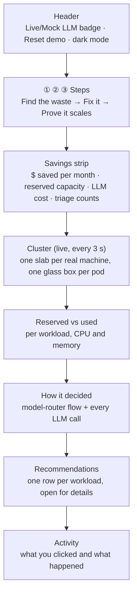

# The AI Control Center, explained

`kubesage serve` opens one page that tells the whole story: **this cluster wastes money, here is the fix, here is
the proof it still works**. This guide walks through it top to bottom, says what every shape and number means,
and gives you the demo to run.

```bash
set -a; . ./.env; set +a                                   # CEREBRAS_API_KEY, for live LLM calls
KUBESAGE_MODELS=cerebras .venv/bin/kubesage serve --host 0.0.0.0
# open http://192.168.1.9:8600 (or http://localhost:8600 on the desktop)
```


## The page at a glance



Read it in two halves:

- **Top half: what to do and what it's worth.** The steps tell you what to press next, and the savings strip
  shows the result of the last analysis.
- **Bottom half: why to believe it.** The cluster drawing is live. The charts and the recommendation rows
  show the evidence and the reasoning behind each change.

## The demo in three steps

The steps strip under the headline is the whole demo. Each step shows a status line, and its number turns
solid once it's done.

| step | press | what happens on screen | what to say |
|---|---|---|---|
| **1 · Find the waste** | **Analyze** | The progress line runs across the top. The headline re-animates and the savings strip, charts and recommendation rows fill in (~5 s with Cerebras). | "It read 30 days of metrics. Four of five workloads need changes, and finding that cost about a cent." |
| **2 · Fix it on the cluster** | **Apply fixes** | Pods on the desktop slab fade out, and new, shorter pods drop onto the laptop slab. The desktop goes empty and the laptop's CPU lights come on. | "It shrank the requests, added autoscaling, and moved everything onto the cheaper machine. The desktop is now idle capacity." |
| **3 · Prove it still scales** | **Send traffic** | A `loadgen` pod appears. checkout-web's glowing cores grow as real CPU climbs, and the autoscaler adds checkout-web pods, up to its max. | "Smaller doesn't mean fragile. Under real load it scales out." |

**Reset demo** (top right) puts everything back: big requests, every pod on the 8600G, and no autoscaling
objects. Use it between rehearsals. It takes about 30 s.

The **Dry run** switch next to Apply asks the API server to validate every change without saving it. Use it
to check a run before touching the cluster.

## Section by section

### Header

- **Live LLM / Mock LLM**: whether Analyze calls a real model. Live needs the API key in the environment (green
  dot). Mock uses deterministic stand-ins with estimated token counts (amber dot).
- **Reset demo**: see above.
- **GitOps PR** (only when the server was started with `--gitops-repo`): commits the run to a GitOps repo
  instead of applying it.
- **Sun/moon**: light/dark theme, remembered per browser.

### Savings strip

The numbers come from the **last analysis run**, not from the live cluster.

| tile | meaning |
|---|---|
| **Saved per month · node pool** | The *billing view*: what the machines cost. Before = the current pool, after = the pool the model picked. Bars compare the two. |
| **Reserved capacity** | The *allocation view*: what the workloads' requests cost at per-core and per-GiB prices, after vs before. |
| **Cost to find it** | What this analysis spent on LLM calls, from each call's token counts and the configured prices. |
| **Workloads** | How triage sorted them: healthy (no more tokens), routine (mid tier), complex (top tier). |

Prices are a **cost model**: Azure list prices from `config/skus.yaml`. The 8600G stands in for a D8s_v5 node
and the 3500U for an F8s_v2. The hardware itself isn't priced.

### Cluster (the isometric drawing)


| shape | meaning |
|---|---|
| **Slab** | A real machine in the cluster. The label under it shows the hostname, its role (control plane / worker), the real CPU model, thread count and RAM, what it uses right now, and what its pods reserve and use. |
| **Glass box** | One pod. Its **height is the CPU the pod reserves** (its request), at 46 px per core. A dashed, blinking box is a Pending pod. |
| **Glowing core** inside the glass | The CPU that pod **uses right now**, from metrics-server. When a new reading arrives, it grows or shrinks smoothly to it. A core taller than its glass means the pod uses more than it reserved. |
| **Tall glass, small core** | Waste: CPU reserved and paid for but not used. That's what step 2 removes. |
| **Two green lights** on the slab's front | Left: the machine is Ready. Right: it is running workload pods. |
| **Ten violet lights** | The machine's CPU right now, one light per 10%. On the laptop that's the whole machine. On the desktop it's the k3d container, i.e. Kubernetes' share only. |
| **Colours** | One colour per workload, the same everywhere on the page. The chips under the drawing are the legend, with pod counts. |
| **Fading box** | A pod shutting down (Terminating). A box that **drops in** from above is a pod that was just created. |

Every motion in the drawing is caused by a real change in the cluster: a pod created, deleted or rescheduled,
or a new usage reading. Nothing moves just for decoration.

**Click** something to see more in the panel on the right:

- **Nothing selected (whole cluster)**: the share of reserved CPU actually used, the machines, their real
  capacity, the cost-model total, and a per-workload table. Click a workload name to select it.
- **A machine**: CPU model, threads and RAM, OS, kernel, Kubernetes version, IP and join time. Two meters show
  what its pods reserve and use against its allocatable capacity, and two more show what the machine uses
  right now. It also shows the cost-model label and its price.
- **A pod or a legend chip (a workload)**: pods ready, its KEDA scaling (min–max, triggers), CPU against the
  autoscaler target, reserved and used, the cost before → after, the model's diagnosis, and each pod with its
  machine. The workload is highlighted in every diagram on the page.

Click empty space, press **Esc** or use the ✕ to go back to the whole cluster.

### Reserved vs used

Two bullet charts, CPU and memory per pod, from the analysis window:

- **Light bar**: what the pod reserves now (its request).
- **Dark bar**: what it actually uses (CPU p95, memory p99).
- **Violet tick**: what KubeSage recommends.
- **Right column**: now → recommended.

A long light bar with a short dark bar is waste. A dark bar longer than the light one means the pod uses more
than it reserves (auth-api's memory: it leaks).

### How it decided

On the left, the **model router** for this run. Each line is a workload:

- **Stats · $0**: Stage 1 is plain arithmetic over the metrics; no model is involved.
- **Triage**: one call to the cheapest tier covers every workload.
- **Fix**: healthy workloads stop at triage and spend nothing more. Routine ones go to the mid tier, complex
  ones to the top tier.

On the right, the **ledger**: every LLM call with its tier, tokens and cost, and the total. Under the flow are
two baselines: the same calls all on the top tier, and sending the raw 5-minute series to the top tier
instead of the Stage 1 statistics.

### Recommendations

One row per workload: status, the tier that handled it, risk, and monthly cost before → after. Open a row for:

- the model's **diagnosis**;
- the measured numbers it was based on;
- **⛨ guardrail** notes: where KubeSage overrode the model (for example "min replicas raised 0 → 1: not a batch
  workload", or "added a CPU trigger");
- **→ follow-ups**: things a human should do, such as fixing a memory leak;
- the **router trace** (the cost of this diagnosis);
- the generated **manifests**.

### Activity

A log of what you did in this browser session: analysis runs, each apply step's result, spikes, resets, errors.

## Interactions

| action | result |
|---|---|
| Hover a pod, machine, bar row or flow line | Tooltip with the numbers |
| Click a pod, chip, bar row or flow line | Select that workload everywhere; the inspector shows it |
| Click a machine | Machine inspector |
| Tab / Enter / Space | Same as hover/click for keyboard users |
| Esc | Clear the selection |
| Hover a legend chip | Highlight that workload without selecting it |

## What is real and what is modelled

| real (measured from the live cluster) | modelled |
|---|---|
| Machines, hardware, OS, Kubernetes version, IPs | Prices: Azure list prices per pool label in `config/skus.yaml` |
| Pods, their requests, phases, restarts, which machine they run on | The 30-day history is a synthetic backfill (`kubesage simulate`) with a live tail from vmagent after it |
| Live CPU and memory per pod and per machine (metrics-server, every ~15 s) | Savings in $: the cost model applied to the analysis |
| KEDA/HPA scaling, CPU against target | |
| LLM calls, token counts and their cost | |
| The load in step 3: real HTTP requests burning real CPU | |

## Glossary

- **Request (reserved)**: the CPU/memory Kubernetes sets aside for a pod. You pay for it whether it's used or not.
- **p95 / p99**: the value a pod stays under 95% / 99% of the time.
- **Allocatable**: what pods can request on a machine after the OS and Kubernetes take their share.
- **KEDA ScaledObject**: the autoscaling rule KubeSage writes: cron windows for known peaks plus a CPU trigger for
  surprises. Scale-to-zero only for batch workloads.
- **Triage tier / worker tier / strategist tier**: cheap, mid and top model. With Cerebras all three are
  `gpt-oss-120b` at low, medium and high reasoning effort.
