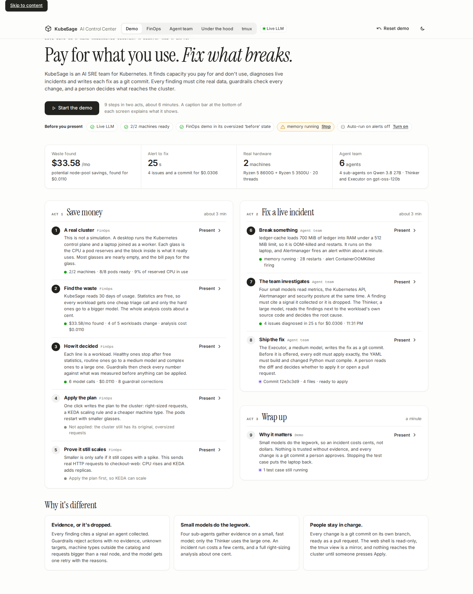
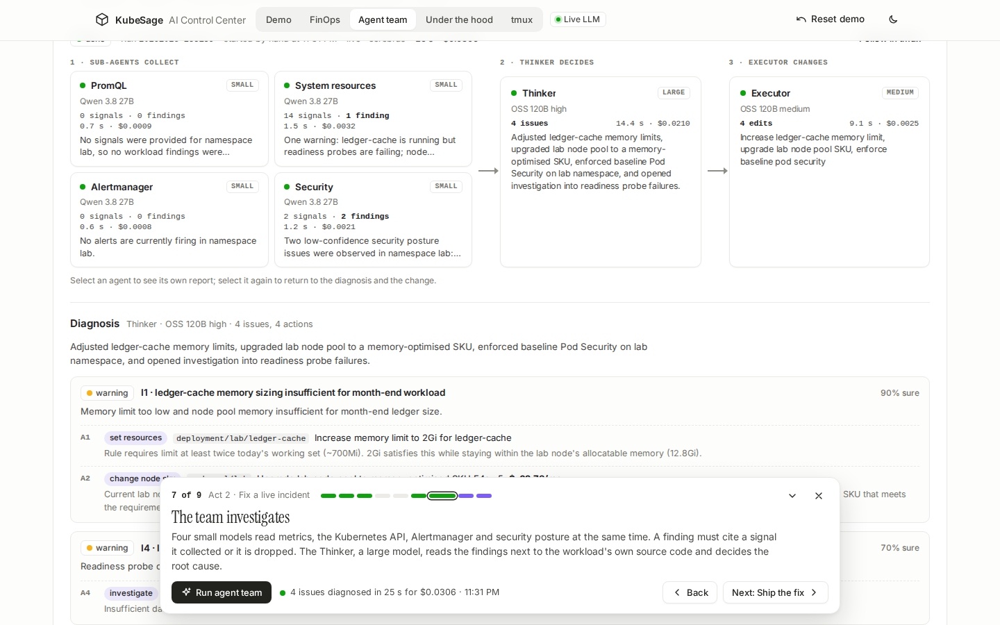
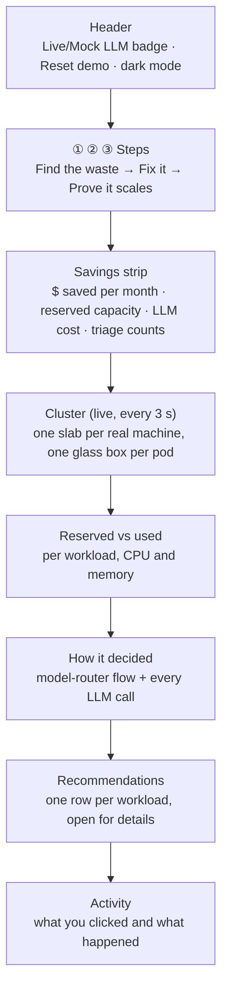
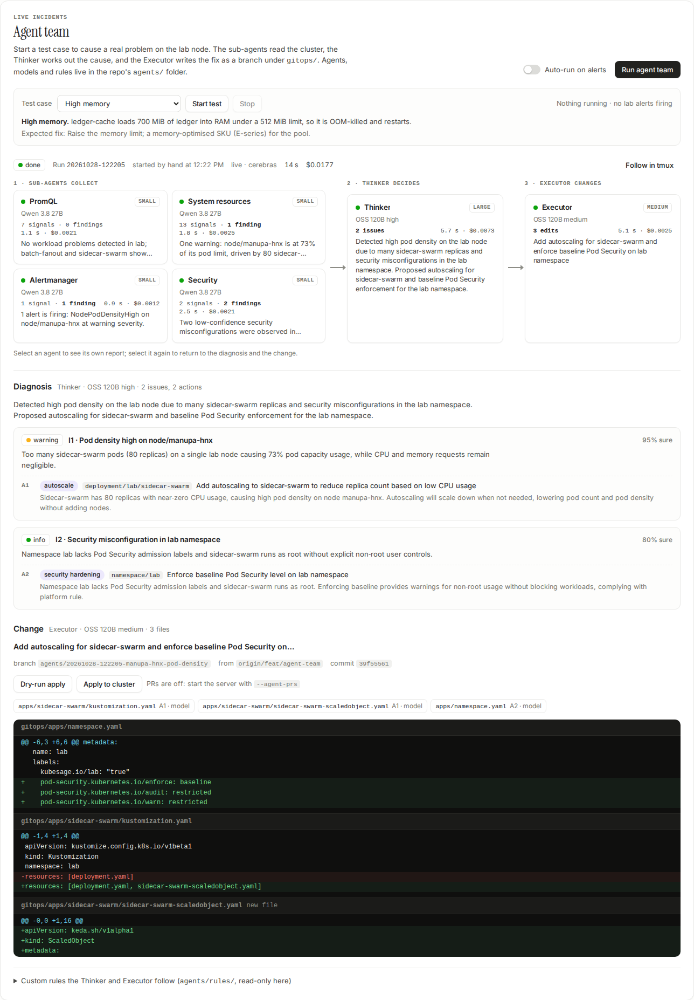
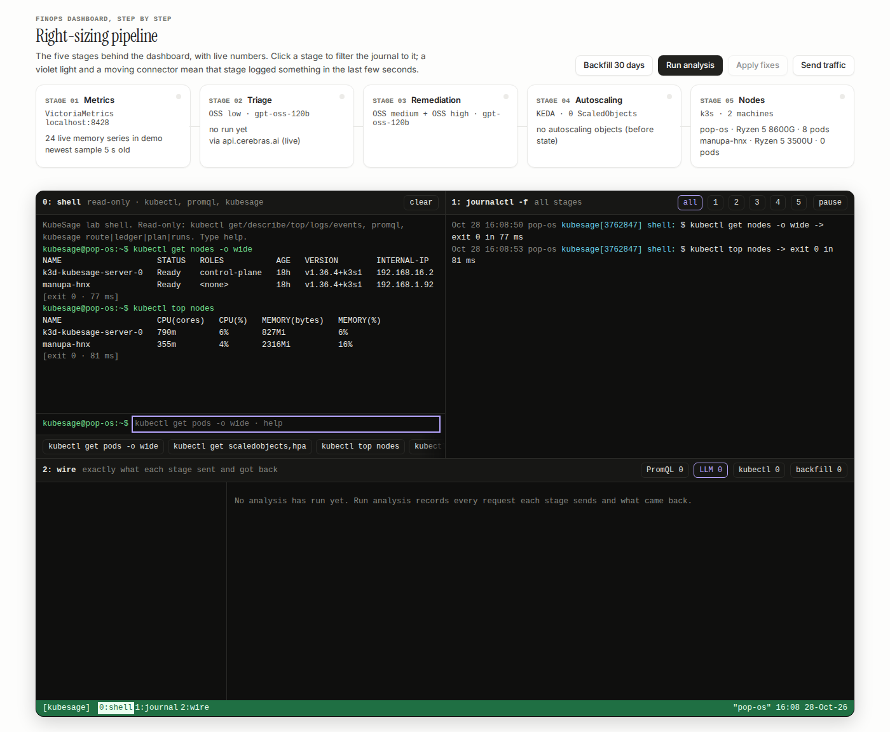
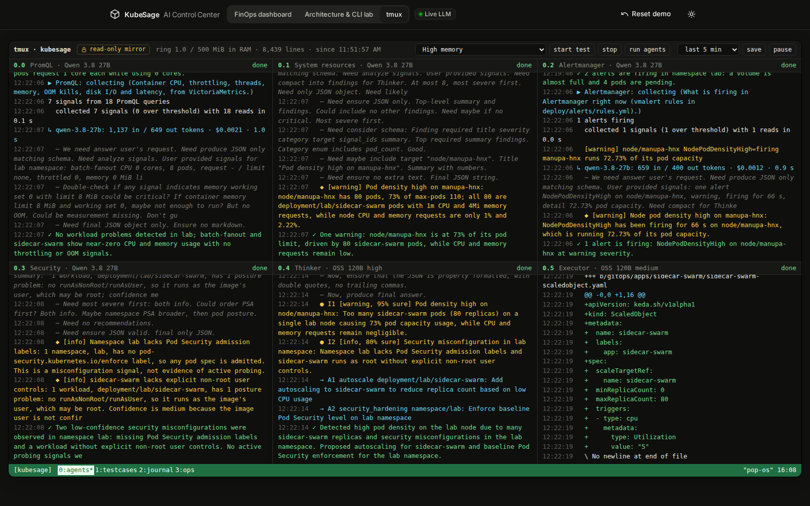

# The AI Control Center, explained

`kubesage serve` opens the AI Control Center. It tells two stories on a real cluster: **this cluster wastes money,
here is the fix and the proof it still works**, and **something just broke, here is the cause and the fix as a git
commit**. This guide gives you the demo to run, then walks through each view and what every shape and number means.

```bash
set -a; . ./.env; set +a                                   # CEREBRAS_API_KEY, for live LLM calls
KUBESAGE_MODELS=cerebras .venv/bin/kubesage serve --host 0.0.0.0
# open http://192.168.1.9:8600 (or http://localhost:8600 on the desktop)
```

The header has five tabs. Each one has its own address (`#demo`, `#dashboard`, `#agents`, `#lab`, `#tmux`), so a
reload or a shared link keeps the view.

| tab | what it is for |
|---|---|
| **Demo** (opens first) | the pitch, live headline numbers, the checks to run before presenting, and the run of show |
| **FinOps** | right-sizing: the savings, the live cluster drawing, the evidence and the three steps |
| **Agent team** | live incidents: test cases, the sub-agents → Thinker → Executor diagram, the diagnosis and the diff |
| **Under the hood** | the right-sizing pipeline stage by stage, a read-only shell, the journal and the wire |
| **tmux** | a read-only mirror of every terminal stream, for following the agents as they work |

Below 900 px the tabs shorten to **Demo · FinOps · Agents · Lab · tmux**; on a phone they get a row of their own.

## Presenting the demo

The **Demo** tab is the page to open in front of judges. Its headline says what KubeSage is, and the four numbers
under it are live: the waste the last analysis found, how long the last incident took from alert to fix, the
real hardware and the agent team's models.



**Before you present** runs the checks from the [demo-day checklist](operations.md#demo-day-checklist) live. Each
chip turns amber with its fix next to it:
- **Live LLM**: amber means Mock (no API key in the server's environment);
- **machines ready**: both nodes Ready;
- **FinOps demo in its 'before' state**: amber with **Reset demo** if a plan is already applied, because Apply then
  has nothing to show;
- **No test case running**: amber with **Stop** if one is left over;
- **Auto-run on alerts**: on or off, with a switch. On, the team starts 45 s after the test case's alert fires;
  off, you press **Run agent team** yourself, which is easier to time when you are presenting.

**Start the demo** walks through the run of show: nine steps, two acts and a wrap-up, about six minutes. Each
step opens the view it happens on, scrolls to what the audience should look at and rings it in violet. A
**caption bar** at the bottom says, in plain words, what the screen shows, so the judges can read along:



- the step's one button (Analyze, Apply fixes, Send traffic, Start test, Run agent team, Apply to cluster or Stop
  test case). It presses the same button as the view itself, so busy states, notices and the activity log work as
  usual;
- a live status line: what that step has produced so far, or what it is waiting for;
- **Back** and **Next**, and a dot per step that jumps there. A dot is green when its step is done, violet while
  it runs and amber when it needs attention;
- collapse (˅) to keep only one line, and × to end. The bar remembers its step if the page reloads.

| # | step | view | press | what the audience sees |
|---|---|---|---|---|
| 1 | A real cluster | FinOps | | the desktop and laptop as slabs, a glass per pod: reserved CPU around a small block of real use |
| 2 | Find the waste | FinOps | **Analyze** | the savings strip fills in: about $34/mo found for about a cent |
| 3 | How it decided | FinOps | | the router flow: free statistics, one cheap triage call, a bigger model only where needed, guardrail corrections |
| 4 | Apply the plan | FinOps | **Apply fixes** | pods restart with smaller glasses and move to the cheaper machine type |
| 5 | Prove it still scales | FinOps | **Send traffic** | real HTTP load: CPU rises and KEDA adds checkout-web replicas |
| 6 | Break something | Agent team | **Start test** | a real problem on the laptop, then its alert. The default is *single-threaded code*: its fix is a code change, which more CPU can't buy |
| 7 | The team investigates | Agent team | **Run agent team** | four sub-agents light up, then the Thinker, then the Executor, with time and cost per agent |
| 8 | Ship the fix | Agent team | **Apply to cluster** | the diagnosis, the commit and its diff; applying it fixes the test case (for single-threaded code: 1 → 3 cores busy) |
| 9 | Why it matters | Demo | **Stop test case** | the three reasons KubeSage is different, and the laptop goes quiet |

Rehearse it once, then **Reset demo** and stop the test case before the judges arrive. The **Present** button on
any row of the run of show starts from that step.

## FinOps


### The page at a glance



Read it in two halves:

- **Top half: what to do and what it's worth.** The steps tell you what to press next, and the savings strip
  shows the result of the last analysis.
- **Bottom half: why to believe it.** The cluster drawing is live. The charts and the recommendation rows
  show the evidence and the reasoning behind each change.

### The three steps

The steps strip under the headline is act 1 of the demo; the caption bar's buttons press these same buttons. Each
step shows a status line, and its number turns solid once it's done.

| step | press | what happens on screen | what to say |
|---|---|---|---|
| **1 · Find the waste** | **Analyze** | The progress line runs across the top. The headline re-animates and the savings strip, charts and recommendation rows fill in (~5 s with Cerebras). | "It read 30 days of metrics. Four of five workloads need changes, and finding that cost about a cent." |
| **2 · Fix it on the cluster** | **Apply fixes** | Resources and scaling rules change. Pods move if enough Ready machines carry the target SKU. Status compares the latest plan with live specs, then reports rollout readiness. | "The guarded plan is applied, and we can check the live result." |
| **3 · Prove it still scales** | **Send traffic** | A `loadgen` pod appears. checkout-web's glowing cores grow as real CPU climbs. The autoscaler can add pods when CPU exceeds its target and replicas are below the maximum. | "Watch CPU against the target and the available replica headroom." |

**Reset demo** (top right) puts everything back: big requests, every pod on the 8600G, and no autoscaling
objects. Use it between rehearsals. It takes about 30 s.

The **Validate only** switch changes the button to **Validate plan**. Kubernetes checks the executable steps
without saving changes. Validation does not mark the plan applied; skipped steps are listed separately.
Open **Review the plan** to inspect machine placement, guardrail adjustments and migration manifests first.
If the target pool lacks enough Ready, schedulable machines, migrations are skipped and the status explains
the shortage. Activity records each written, skipped or failed step.

Step 3 shows current/max replicas and CPU against the autoscaler target. **Traffic settings** exposes CPU work
per request and estimates the load as `requests/s × milliseconds / 1000` CPU cores. The default 60 requests/s
at 50 ms is about three real cores: enough to make checkout-web scale out (80 requests/s hit the replica
ceiling with HTTP errors in a live run). At the replica limit, CPU can rise without more pods. Active traffic
jobs are rediscovered after a reload; the countdown is an estimate, not proof of successful requests.
The traffic result panel shows successful and failed requests, plus the latest interval's p50/p95 latency.
Request errors stay visibly marked even if Kubernetes reports the Job as completed. When logs are missing,
the panel says results are unavailable. A busy autoscaler does not by itself prove requests are healthy.

### Section by section

#### Header

- **Live LLM / Mock LLM**: whether Analyze calls a real model. Live needs the API key in the environment (green
  dot). Mock uses deterministic stand-ins with estimated token counts (amber dot).
- **Reset demo**: see above.
- **GitOps PR** (only when the server was started with `--gitops-repo`): commits the run to a GitOps repo
  instead of applying it.
- **Sun/moon**: light/dark theme, remembered per browser.

#### Analysis runs and downloads

The **Analysis run** selector lists completed reports, newest first. Choosing a historical report updates
the figures, charts, reasoning and recommendations while live cluster polling continues. Apply and GitOps
use the selected run even if a newer analysis appears. Live plan verification currently compares the latest
analysis; historical views say that they are older rather than displaying its verification result.

**Download report** saves the selected JSON snapshot. **Download manifests** saves its workload and migration
manifests in one YAML bundle. Individual recommendation rows also offer workload manifest downloads.

#### Savings strip

The numbers come from the **selected analysis snapshot**, not from the live cluster. The run and observation
window appear above them; applying changes does not rewrite this evidence.

| tile | meaning |
|---|---|
| **Potential monthly savings / Additional monthly capacity** | The *billing view*: modelled machine cost before and after. A higher cost is shown as additional capacity rather than savings. Bars compare the two. |
| **Planned reservations** | The *allocation view*: what the workloads' requests cost at per-core and per-GiB prices, after vs before. |
| **Cost to find it** | What this analysis spent on LLM calls, from each call's token counts and the configured prices. |
| **Workloads** | How triage sorted them: healthy (no more tokens), routine (mid tier), complex (top tier). |

Prices are a **cost model**: Azure list prices from `config/skus.yaml`. The 8600G stands in for a D8s_v5 node
and the 3500U for an F8s_v2. The hardware itself isn't priced.

The node pool is sized for scheduled peaks. Maximum CPU autoscaler demand is calculated separately, and the
plan notes explain whether that burst fits or exceeds the modelled pool. This does not guarantee scheduler
placement or reserve every workload's maximum at once. Workload costs use the scheduled average replica
count, with overlapping cron windows taking the largest active target; unpredictable CPU scale-out is
excluded from that average. A workload can also cost
more when safety guardrails require more CPU, memory or replicas. These estimates are potential changes,
not a measured bill reduction.

#### Cluster (the isometric drawing)


| shape | meaning |
|---|---|
| **Slab** | A real machine in the cluster. The label under it shows the hostname, its role (control plane / worker), the real CPU model, thread count and RAM, what it uses right now, and what its pods reserve and use. |
| **Glass box** | One pod. Its **height is the CPU the pod reserves** (its request), at 46 px per core. A dashed, blinking box is a Pending pod. |
| **Glowing core** inside the glass | The CPU that pod **uses right now**, from metrics-server. When a new reading arrives, it grows or shrinks smoothly to it. A core taller than its glass means the pod uses more than it reserved. |
| **Tall glass, small core** | Waste: CPU reserved and paid for but not used. That's what step 2 removes. |
| **Two green lights** on the slab's front | Left: the machine is Ready. Right: it is running workload pods. |
| **Ten violet lights** | The machine's CPU right now, one light per 10%. On the laptop that's the whole machine. On the desktop it's the k3d container, i.e. Kubernetes' share only. |
| **Colours** | One colour per workload, the same everywhere on the page. The chips under the drawing are the legend, with pod counts. |
| **Fading box** | A pod shutting down (Terminating). A box that **drops in** from above is a pod that was just created. |

Every motion in the drawing is caused by a real change in the cluster: a pod created, deleted or rescheduled,
or a new usage reading. Nothing moves just for decoration.

**Click** something to see more in the panel on the right:

- **Nothing selected (whole cluster)**: the share of reserved CPU actually used, the machines, their real
  capacity, the cost-model total, and a per-workload table. Click a workload name to select it.
- **A machine**: CPU model, threads and RAM, OS, kernel, Kubernetes version, IP and join time. Two meters show
  what its pods reserve and use against its allocatable capacity, and two more show what the machine uses
  right now. It also shows the cost-model label and its price.
- **A pod or a legend chip (a workload)**: pods ready, its KEDA scaling (min–max, triggers), CPU against the
  autoscaler target, reserved and used, the cost before → after, the model's diagnosis, and each pod with its
  machine. The workload is highlighted in every diagram on the page. For the latest plan, **View differences
  from this plan** lists fields whose live and planned values differ.

Click empty space, press **Esc** or use the ✕ to go back to the whole cluster.

#### Reserved vs used

Two bullet charts, CPU and memory per pod, from the analysis window:

- **Light bar**: what the pod reserved when this analysis ran (its request).
- **Dark bar**: what it actually uses (CPU p95, memory p99).
- **Violet tick**: what KubeSage recommends.
- **Right column**: at analysis → recommended.

A long light bar with a short dark bar is waste. A dark bar longer than the light one means the pod uses more
than it reserved (auth-api's memory: it leaks). These charts stay fixed after Apply. Use the cluster inspector
for current requests and usage.

#### How it decided

On the left, the **model router** for this run. Each line is a workload:

- **Stats · $0**: Stage 1 is plain arithmetic over the metrics; no model is involved.
- **Triage**: one call to the cheapest tier covers every workload.
- **Fix**: healthy workloads stop at triage and spend nothing more. Routine ones go to the mid tier, complex
  ones to the top tier.

On the right, the **ledger**: every LLM call with its tier, tokens and cost, and the total. Under the flow are
two baselines: the same calls all on the top tier, and sending the raw 5-minute series to the top tier
instead of the Stage 1 statistics.

#### Recommendations

One row per workload: status, the tier that handled it, risk, and monthly cost before → after. Open a row for:

- the model's **diagnosis**;
- the measured numbers it was based on;
- **⛨ guardrail** notes: where KubeSage overrode the model (for example "min replicas raised 0 → 1: not a batch
  workload", or "added a CPU trigger");
- **→ follow-ups**: things a human should do, such as fixing a memory leak;
- the **router trace** (the cost of this diagnosis);
- the generated **manifests**.

Search by workload name or filter to changes proposed, healthy, routine or complex workloads. A cost increase
is labelled as an increase; read the guardrail notes and scaling plan to understand the extra capacity.

#### Activity

A log of what you did in this browser session: analysis runs, each apply step's result, spikes, resets, errors.
Live plan status and active traffic are reconstructed from Kubernetes after a reload; this activity log and
the browser's last validation result are session information.

## Agent team

Live incidents. A test case causes a real problem on the laptop, and the agent team finds the cause and writes the
fix. [agents.md](agents.md) explains the agents, models and rules behind it.



- **Run agent team** (top right, beside the title) runs it now. With **Auto-run on alerts** on, the team runs 45 s after a new lab
  alert fires.
- The **test case** box: the dropdown, **Start test** and **Stop** deploy or remove one of the nine live test cases
  in the `lab` namespace (high memory, CPU throttled, single-threaded code, disk I/O, disk storage, latency,
  Pending pods, pod density, a hand-made insecure pod). Under them: what the test case does and the fix to expect.
  On the right, badges show running test cases with their pod phases and restarts, and the lab alerts firing in
  Alertmanager.
- The **run bar**: the last run's state, id, how and when it started, how long it took, what it cost, and
  **Follow in tmux**.
- The **team diagram**, left to right: *1 · Sub-agents collect* (four cards, small model) → *2 · Thinker decides*
  (large) → *3 · Executor changes* (medium). Each card shows its model, signals or findings, time and cost, and a
  light: violet while it works, green when done, red on error. An arrow's dashes move while the next agent works.
- Under it, **Diagnosis**: the Thinker's summary, then each issue with its severity, confidence and root cause, and
  its actions (type, target, what to do and why; SKU changes add their monthly cost). Then **Change**: the
  Executor's commit title, branch and commit, the changed files and a diff split by file. Select a sub-agent card
  for its own findings and over-threshold signals instead; select it again to go back.
- Change buttons: **Dry-run apply** (`kubectl apply --dry-run=server`), **Apply to cluster** (asks first; lab
  namespace intended; deterministic namespace enforcement is pending in PR #16; Terraform is never applied), **Open pull request** (only with `--agent-prs`).
- **Custom rules**: the `agents/rules/` files the Thinker and Executor follow, read-only here.

## Under the hood

The engineering view exposes server readings, log lines and request traces. Mock LLM mode and synthetic
metrics backfill are supported; check the mode and source of each result. It has two parts, and the
**Pipeline · Terminal** buttons under the title jump to each:
1. the **right-sizing pipeline**, the five stages behind the FinOps view;
2. the **terminal**: shell, journal and wire panes.



- **Pipeline actions**, beside the pipeline's title: Backfill 30 days, Run analysis, Apply fixes and Send traffic.
  They are the dashboard's actions, with the same operation lock (**Reset demo** stays in the header). Backfill is
  the lab's own. It regenerates the 30-day scenario history in VictoriaMetrics, which **replaces** everything stored
  for the namespace, including the live tail, so it asks first.
- **Dataflow, five stages**:
  1. **Metrics**: VictoriaMetrics, its live series and how old the newest sample is, plus the PromQL queries the
     selected run made.
  2. **Triage**: the cheap tier's model, plus its tokens, cost and latency in the run, and the healthy/routine/complex
     counts.
  3. **Remediation**: the worker and strategist tiers, calls, cached tokens, guardrail overrides and the node-pool
     decision.
  4. **Autoscaling**: KEDA ScaledObjects and HPA pods, with CPU against the target.
  5. **Nodes**: the real machines and their pods.

  Model names come from the active profile (`KUBESAGE_MODELS`), e.g. Cerebras' `gpt-oss-120b` or Meta's Muse tiers.
  A violet light and a moving connector mean that stage logged something in the last few seconds. Clicking a stage
  filters the journal to it.
- **Shell** (pane 0): a read-only allow-list.
  - `kubectl get / describe / top / logs / events / version / cluster-info / api-resources`. Secrets, `exec`,
    `--watch` and `-f` are not available, and `logs` is capped at 500 lines.
  - `promql '<expr>' [--range 1h --step 1m]`.
  - `kubesage route | ledger | plan | runs | config`.
  - `help`, `history` and `clear`.
  - Shortcut keys along the bottom, ↑/↓ for history, Tab to complete, Ctrl+L to clear.

  Input never reaches a shell: it is split with shlex, each token is checked, and kubectl gets an argument list.
  The page has no login, so this is the most it can safely offer to anyone who can reach port 8600. Changes go
  through the action buttons.
- **Journal** (pane 1, `journalctl -f` style): every query, LLM call (tokens, cost, latency), guardrail override,
  node-pool decision, kubectl step, operation start/finish, shell command and load-generator interval, plus the
  namespace's real Kubernetes events (Scheduled, Killing, SuccessfulRescale, BackOff…). Filter by stage, or pause
  scrolling.
- **Wire** (pane 2): for the selected run:
  - every PromQL request with its parameters, series count and timing;
  - every LLM request body as sent, with the provider's response, usage (reasoning and cached tokens included) and
    the parsed answer;
  - the exact `kubectl` calls Apply makes, with their manifests;
  - the four VictoriaMetrics requests of the last Backfill, with a preview of the import body.

  **Copy as curl** reproduces a request. The API key appears only as its variable (`$CEREBRAS_API_KEY`) and is
  never stored or sent to the browser. Runs from before request tracing show no exchanges.

On a phone the stages stack, and the terminal shows one pane at a time; switch panes from the green status bar.

## tmux

The header's last tab is a read-only mirror of the server's RAM ring, laid out like tmux:
- window **0:agents**: one pane per agent, with its signals, findings, model calls and their reasoning, edits
  and the diff, as they happen;
- **1:testcases**: test-case starts and stops, the test pods' own logs, alerts, and
  `kubectl get pods,events -n lab -w`;
- **2:journal**: the lab journal, and requests that got a 403 or 404 or a refused shell command;
- **3:ops**: whatever the presenter types in the `ops` window of `kubesage tmux` on the server, piped in as text.

Each agent pane's title shows the agent, its model and its state in the last run. The model's own reasoning is
grey italic, so the findings (yellow), results (green) and edits stand out.

Nothing typed in the browser reaches a terminal: there is no input box, and the ring has no write endpoint (the
**read-only mirror** badge). The top bar has the ring's size in RAM, the test-case controls and **run agents**,
then **save** (the last 5 or 30 minutes, or everything held, as a text file) and **pause**. **zoom** on a pane
fills the window with it, like tmux's prefix z (the status bar marks the window `Z`).

**Beside the other views.** **tmux panel** in the header (top right, next to the theme toggle), or **open as side
panel** in the tmux top bar, opens the mirror as a column on the right of Demo, FinOps, Agent team and Under the hood, so you can watch the
agents while you present. It has its own window (pick it from its green status bar) and zoom, **full view** opens
the tmux tab, and **close** puts it away. Drag its left edge to make it wider (or focus the edge and use ← →). It
hides while the tmux tab is open (turning it on from there takes you back to the last view), and the browser remembers whether it was open, its width and its window. On a
tablet it is a sheet across the bottom; on a phone use the tmux tab.

The first load takes the newest lines of each feed separately, so an agent pane still shows the last team run
after hours of `kubectl -w` output.



## Interactions

| action | result |
|---|---|
| Hover a pod, machine, bar row or flow line | Tooltip with the numbers |
| Click a pod, chip, bar row or flow line | Select that workload everywhere; the inspector shows it |
| Click a machine | Machine inspector |
| Tab / Enter / Space | Same as hover/click for keyboard users |
| Esc | Clear the selection |
| Hover a legend chip | Highlight that workload without selecting it |

## What is real and what is modelled

| real (measured from the live cluster) | modelled |
|---|---|
| Machines, hardware, OS, Kubernetes version, IPs | Prices: Azure list prices per pool label in `config/skus.yaml` |
| Pods, their requests, phases, restarts, which machine they run on | The 30-day history is a synthetic backfill (`kubesage simulate`) with a live tail from vmagent after it |
| Live CPU and memory per pod and per machine (metrics-server, every ~15 s) | Savings in $: the cost model applied to the analysis |
| KEDA/HPA scaling, CPU against target | |
| LLM calls, token counts and their cost | |
| The load in step 3: real HTTP requests burning real CPU | |

## Glossary

- **Request (reserved)**: the CPU/memory Kubernetes sets aside for a pod. You pay for it whether it's used or not.
- **p95 / p99**: the value a pod stays under 95% / 99% of the time.
- **Allocatable**: what pods can request on a machine after the OS and Kubernetes take their share.
- **KEDA ScaledObject**: the autoscaling rule KubeSage writes: cron windows for known peaks plus a CPU trigger for
  surprises. Scale-to-zero only for batch workloads.
- **Triage tier / worker tier / strategist tier**: cheap, mid and top model. With Cerebras all three are
  `gpt-oss-120b` at low, medium and high reasoning effort.
