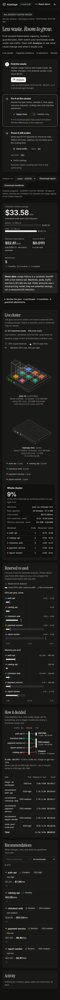

# Control Center review · 2026-10-27

The dashboard now separates an immutable analysis snapshot from live Kubernetes state. It offers report
history, pinned Apply/GitOps actions, JSON/YAML downloads, searchable recommendations and field-level drift
inspection. The plan review explains placement, guardrail adjustments and estimated costs before applying.

Validation checks Kubernetes without marking the plan applied. Live Deployment and ScaledObject fields
determine application status across reloads; rollout readiness and available target-machine capacity are
checked separately. Failed and skipped commands remain visible. An operation in another tab disables
conflicting controls. Report publication is atomic and existing runs cannot be overwritten.

The keyboard selection survives polling. Diagrams have visible focus and descriptive labels; tooltips are
linked to focused objects. Mobile charts use separate label/value and bar lines, ledger numbers stay
together, and reduced motion disables animations. Inter and Instrument Serif remain local assets, with
one script, no CDN and no build step.

## Live verification

The real desktop/laptop cluster was exercised through Chromium using the live Cerebras profile:

| Check | Result |
|---|---|
| Analyze | Run `20261027-222729-780339`: six live calls, $0.011127 |
| Validate only | 11/11 manifests checked, no skips |
| Apply | 11/11 commands succeeded; planned workload placement and live specs matched |
| Reload | Applied state reconstructed from Kubernetes; rollout ready |
| Traffic | One run at 80 requests/s × 50 ms CPU for 180 seconds; HPA increased checkout-web from 3 to 4 replicas |
| Scaling limit | CPU reached about 123% against its 70% target at the four-replica ceiling |
| Request health | The heavy load produced request errors and multi-second p95 latency; this was a saturation test, not an error-free throughput result |
| Metrics outage | Briefly stopped only KubeSage VictoriaMetrics; Analyze returned a readable 502, then the service was restored |
| Cross-machine access | Laptop test pod resolved cluster DNS and reached the checkout Service |
| Cleanup | Demo reset: both nodes Ready, eight original pods on the desktop, no traffic jobs |

The saturation finding led to an additional traffic result panel: success/error counters and latest p50/p95
latency are read from bounded, cached job logs. A completed Job with failed requests remains visibly marked;
unavailable results are never presented as zero errors. The parser and UI states are covered by deterministic
tests without repeating the live load or spending more LLM credit.

Automated validation: 73 pytest tests and 17 isolated Chromium browser scenarios. Responsive checks cover
390, 768 and 1400 pixels in light/dark mode, including a three-machine/32-pod stress layout. Firefox 155
rendering was checked using settled DOM snapshots at the same sizes and themes; interactive regression
coverage uses Chromium. Browser screenshots and fixtures do not require a running cluster.

## Remaining limits

- Live drift verification compares the latest analysis in the configured namespace. Older reports are
  clearly labelled and actions use their selected run, but they do not receive a historical verification badge.
- Prices remain a cloud cost model; history is synthetic backfill plus live samples. Moving pods does not
  automatically remove hardware or reduce a real bill.
- The traffic test can hit a replica or physical-machine limit. Review request errors and latency alongside
  CPU and replica counts; lower the traffic settings when demonstrating recovery rather than saturation.
- The server retains its existing LAN access model; the handover's authentication limitation still applies.
